# Project 1 - Network Deployment, Measurement and Observability (Scenario A)

**Course:** DE0849 Telecommunications Software - Riga Technical University (2026/27)
**Author:** Vasif Yusifli, 261AEM001
**Scenario:** A - Software-based telecommunications network, *Hybrid Linux namespaces + Docker*
**Workflow:** Deploy → Verify → Observe → Measure → Diagnose → Explain

This repository contains everything that was used to build, test, measure and analyse the
network: deployment scripts, Docker Compose services, measurement/impairment scripts, the raw
results, packet captures, the structured dataset, the Python analysis and this report.
All numbers below were produced by the scripts in this repository on the test system described in
[§3](#3-system-requirements-and-reproduction).

---

## Contents

1. [Key findings](#1-key-findings)
2. [Architecture](#2-architecture)
3. [System requirements and reproduction](#3-system-requirements-and-reproduction)
4. [Step 1 - Deployment and end-to-end operation](#4-step-1---deployment-and-end-to-end-operation)
5. [Step 2 - Traffic observation and protocol behaviour](#5-step-2---traffic-observation-and-protocol-behaviour)
6. [Step 3 - Performance measurement and network degradation](#6-step-3---performance-measurement-and-network-degradation)
7. [Operational observability - Prometheus and Grafana](#7-operational-observability---prometheus-and-grafana)
8. [Failure diagnosis (evidence chains)](#8-failure-diagnosis-evidence-chains)
9. [Data pipeline and repository layout](#9-data-pipeline-and-repository-layout)
10. [Known limitations](#10-known-limitations)
11. [References](#11-references)

---

## 1. Key findings

| # | Finding | Evidence |
|---|---|---|
| 1 | The complete path UE → Access → Core → Host → Docker bridge → Nginx/iperf3 is operational at every layer: routes, forwarding, listening sockets, HTTP 200 and 4-hop traceroute. | [§4](#4-step-1---deployment-and-end-to-end-operation), `results/step1/` |
| 2 | Simultaneous capture at four points shows the **same** packets everywhere (0 kernel capture drops). The IP TTL drops 64 → 63 → 62 → 61, which proves that each router forwarded them. The one-way forwarding time UE → Docker bridge is 80-150 µs. | [§5](#5-step-2---traffic-observation-and-protocol-behaviour) |
| 3 | Baseline: RTT 0.17 ms, TCP 3.3 Gbit/s up / 3.0 Gbit/s down, UDP 30 Mbit/s with 0 % loss, HTTP median 0.56 ms (CV of throughput < 1 %). | Table 6.3 |
| 4 | **+50 ms RTT** cuts TCP throughput by 84 % (3327 → 521 Mbit/s) with zero loss. The flow becomes window-limited by the 4 MiB send buffer (`tcp_wmem` max): ≈ 3.6 MB in flight / 55.8 ms sRTT. HTTP grows to exactly 2 RTT (102 ms), and the 1 MiB transfer takes 9 RTT (slow start). UDP is unaffected. | Fig. 2, 5, 7 |
| 5 | **1 % loss** cuts TCP to ≈ 300 Mbit/s with ≈ 2,700 retransmissions per 10 s. This agrees with the Mathis model (376 Mbit/s bound). UDP simply loses 0.95 % of the datagrams, with no retransmission. | Fig. 3, 4, `results/model_check.md` |
| 6 | **Delay and loss together** are multiplicative: TCP collapses to 3.4 Mbit/s (Mathis bound 2.7 Mbit/s). The HTTP p95 rises to 278 ms (SYN/RTO recovery). | Table 6.3 |
| 7 | **20 Mbit/s token bucket**: TCP gets 19.1 Mbit/s, which is exactly 20 × 1448/1514, the Ethernet/IP/TCP overhead. UDP offered at 30 Mbit/s loses 34.7 %, because UDP has no congestion control. The tbf queue adds ≈ 57 ms of sRTT (bufferbloat). | Fig. 4 |
| 8 | **Impairment location** (access-core vs core-DN link) does **not** change end-to-end metrics on a serial path. It changes **where** the evidence appears: qdisc drop counters and the capture point at which packets disappear. | Fig. 6, §6.6 |
| 9 | **Prometheus/Grafana timeline:** the bottleneck queue of the 20 Mbit/s limit raises the RTT of *other* traffic to 58 ms (HTTP 118 ms) while a TCP flow is running. A long-lived flow hit by +50 ms RTT recovers much more slowly (164 Mbit/s median) than a fresh flow (521 Mbit/s). | Fig. 9, 10, §7.2 |
| 10 | The unimpaired baseline shows hundreds to thousands of TCP retransmissions per 10 s. Diagnosis: no packet is lost on the path. The retransmissions are triggered by **packet reordering** in the multi-CPU veth software path, and about half of them are confirmed spurious by DSACK. | [§8.1](#81-f0---tcp-retransmissions-in-the-unimpaired-baseline-found-not-injected) |
| 11 | Three injected failures (missing return route, forwarding disabled, application container stopped) were each localised by comparing captures at several points and checking system counters. This works even where the obvious checks (`docker ps`, ping to the next hop) look healthy. | [§8](#8-failure-diagnosis-evidence-chains) |

---

## 2. Architecture

### 2.1 Topology

The reference chain *UE / Client → Access Network → Core Network / Gateway → Data Network →
Application Server* is built on one Linux VM:

* **Linux network namespaces** (`ue`, `access`, `core`) provide the UE, the access router and the core gateway.
* **veth pairs** connect them.
* The **root namespace (host)** is the integration boundary to Docker.
* A Docker **user-defined bridge** (`scena-dn`, Linux bridge `br-dn`) is the data network with the Nginx application server and the iperf3 performance server.
* Prometheus and Grafana run on a **separate** Docker network (`scena-obs`) and are *not* part of the traffic path.

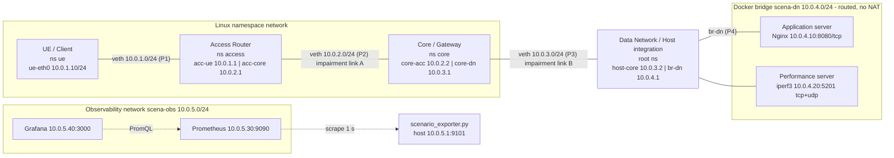

P1-P4 are the packet observation points used throughout the report: `ue-eth0`, `acc-core`, `core-dn` and `br-dn`.

### 2.2 Addressing, interfaces and services

| Entity | Implementation | Interface | IP address | Peer / gateway | Subnet |
|---|---|---|---|---|---|
| UE / Client | netns `ue` | `ue-eth0` | 10.0.1.10/24 | default via 10.0.1.1 | 10.0.1.0/24 |
| Access Router | netns `access`, ip_forward=1 | `acc-ue` / `acc-core` | 10.0.1.1/24 / 10.0.2.1/24 | core 10.0.2.2 | 10.0.1.0/24, 10.0.2.0/24 |
| Core / Gateway | netns `core`, ip_forward=1 | `core-acc` / `core-dn` | 10.0.2.2/24 / 10.0.3.1/24 | access 10.0.2.1, host 10.0.3.2 | 10.0.2.0/24, 10.0.3.0/24 |
| Data Network / Host | root namespace, ip_forward=1 | `host-core` / `br-dn` | 10.0.3.2/24 / 10.0.4.1/24 | core 10.0.3.1 | 10.0.3.0/24, 10.0.4.0/24 |
| Application server | container `scena-nginx` (custom image `nginx:1.27-alpine`) | `eth0` | 10.0.4.10/24 | 10.0.4.1 | 10.0.4.0/24 |
| Performance server | container `scena-iperf3` (`networkstatic/iperf3`) | `eth0` | 10.0.4.20/24 | 10.0.4.1 | 10.0.4.0/24 |
| Prometheus / Grafana | containers on `scena-obs` | `eth0` | 10.0.5.30 / 10.0.5.40 | 10.0.5.1 | 10.0.5.0/24 |

| Node | Routing table (relevant entries) |
|---|---|
| UE | `default via 10.0.1.1 dev ue-eth0` |
| Access | `10.0.3.0/24 via 10.0.2.2`, `10.0.4.0/24 via 10.0.2.2` |
| Core | `10.0.1.0/24 via 10.0.2.1`, `10.0.4.0/24 via 10.0.3.2` |
| Host | `10.0.1.0/24 via 10.0.3.1`, `10.0.2.0/24 via 10.0.3.1`, `10.0.4.0/24 dev br-dn` (connected) |
| Containers | `default via 10.0.4.1` |

| Service | Endpoint | Transport | Purpose |
|---|---|---|---|
| Nginx | 10.0.4.10:8080 | TCP | `/` (421 B page), `/files/1M.bin` (1 MiB), `/health`, `/nginx_status` |
| iperf3 | 10.0.4.20:5201 | TCP (control and data), UDP (data) | throughput, loss and jitter |
| Exporter | 10.0.5.1:9101 | TCP/HTTP | Prometheus metrics (observability plane only) |
| Prometheus / Grafana | 127.0.0.1:9090 / 127.0.0.1:3000 | TCP/HTTP | time-series storage and dashboard |

### 2.3 Design decisions

| Decision | Reason |
|---|---|
| Docker bridge in **`gateway_mode_ipv4=routed`** plus two `DOCKER-USER` accept rules | Docker 28+ drops packets that are routed to a container from a non-bridge interface (raw-table rule) and NATs outgoing traffic. With routed mode, the UE's real address 10.0.1.10 reaches Nginx (visible in the Nginx log), so the path is a true L3 path without NAT. |
| **TSO/GSO/GRO disabled** on every veth and container `eth0` | Otherwise tc/netem sees 64 KB "super-packets". One netem loss event would then drop ~44 wire packets, and captures would show frames that never exist on a wire. With offloads off, every skb is one 1500-byte packet. |
| Impairment on **both directions of one link** (egress of both ends) | A real link degradation affects both directions. `delay 25ms` per direction gives +50 ms RTT. |
| `netem limit 10000` | The default 1000-packet netem queue would silently tail-drop at high BDP and turn the delay experiment into a loss experiment. |
| Nginx content **baked into the image** (`deploy/nginx/Dockerfile`) | The first version bind-mounted the content from a Windows (9p) folder, which added ~10 ms to each response. It was detected in the first Step 2 capture: 10 ms between the request ACK and the response. |
| Observability on a **separate Docker network** | Prometheus/Grafana are measurement infrastructure, not user-plane functions. |
| `net.core.netdev_max_backlog = 10000` | With offloads off, the ~270 kpps per flow overflowed the default 1000-packet per-CPU input backlog during early tests (veth `rx_dropped`). |

---

## 3. System requirements and reproduction

**Test system:**

* Windows 11 + WSL2 (kernel 6.18.33.2-microsoft-standard-WSL2), Ubuntu 26.04.1 LTS, 4 vCPU, 3.9 GB RAM
* Docker 29.1.3, Docker Compose 2.40.3
* iperf3 3.20, tcpdump 4.99.6, TShark 4.6.4, curl 8.18.0
* Python 3.14 with numpy, pandas and matplotlib

Any Ubuntu 22.04+ VM with the `sch_netem` and `sch_tbf` kernel modules works.

```bash
git clone <this repository> && cd DE0849-Project1-ScenarioA
sudo ./scripts/00_install.sh        # packages, Docker images, Python venv in /opt/p1venv
sudo ./scripts/run_all.sh           # everything below in sequence (~35 min)
```

| Stage | Command | Output |
|---|---|---|
| Deploy | `sudo ./scripts/01_deploy.sh` | namespaces, veths, routes, containers |
| Verify (Step 1) | `sudo ./scripts/02_verify.sh` | `results/step1/*.txt` |
| Observe (Step 2) | `sudo ./scripts/03_capture.sh` | `captures/step2/*.pcap`, `captures/step2/analysis/` |
| Measure (Step 3) | `sudo ./scripts/05_experiments.sh 3` (calls `impair.sh` and `04_measure.sh`) | `results/raw/<condition>/`, `captures/step3/` |
| Diagnose | `sudo ./scripts/06_failure.sh`, `sudo ./scripts/08_baseline_retrans_diagnosis.sh` | `results/failure/`, `results/baseline_retrans/` |
| Observability | `sudo ./scripts/07_timeline.sh` | Prometheus TSDB, `results/timeline/` |
| Analyse | `cd analysis && /opt/p1venv/bin/python parse_results.py && ... analyze.py step2_analysis.py failure_analysis.py timeline.py` | `data/*.csv`, `figures/*.png`, `results/*.md` |
| Manual impairment | `sudo ./scripts/impair.sh apply access-core netem delay 25ms` / `... clear` / `... show` | |
| Remove | `sudo ./scripts/99_teardown.sh` | |

Grafana is available at <http://localhost:3000> (anonymous viewer, dashboard *Scenario A - Network
Observability*). Prometheus is at <http://localhost:9090>.

---

## 4. Step 1 - Deployment and end-to-end operation

### 4.1 What was verified and how

`scripts/02_verify.sh` checks the deployment layer by layer and stores every command with its output in
`results/step1/`.

| Layer | Check | Observation (from `results/step1/`) |
|---|---|---|
| Namespaces | `ip netns list` | `core`, `access`, `ue` |
| L2 links | `ip -d link show type veth` | each veth end reports its peer namespace (`link-netns access`, ...), state UP, MTU 1500 |
| L3 addressing | `ip -br addr` per namespace | addresses as in Table 2.2 |
| Routing | `ip route`, `ip route get 10.0.4.10` in each node | UE → `via 10.0.1.1`, access → `via 10.0.2.2`, core → `via 10.0.3.2`, host → `dev br-dn` (connected); return path from the host to 10.0.1.10 → `via 10.0.3.1 dev host-core` |
| Forwarding | `sysctl net.ipv4.ip_forward` | access = 1, core = 1, host = 1, UE = 0 |
| Docker network | `docker network inspect scena-dn` | subnet 10.0.4.0/24, gateway 10.0.4.1, `gateway_mode_ipv4=routed`; nginx 10.0.4.10, iperf3 10.0.4.20 |
| Services | `nsenter -t <pid> -n ss -tulnp` | nginx `LISTEN 0.0.0.0:8080`, iperf3 `LISTEN *:5201` |
| Hop reachability | `ping` to every interface on the path | 0 % loss to all eight addresses |
| Path | `traceroute -n 10.0.4.10` | `1 10.0.1.1 → 2 10.0.2.2 → 3 10.0.3.2 → 4 10.0.4.10` |
| PMTU | `tracepath` | `pmtu 1500 hops 4` |
| Application | `curl -v http://10.0.4.10:8080/` | `HTTP/1.1 200 OK`, `Server: nginx/1.27.5`, 421 B, connect 0.16 ms, total 0.48 ms |
| Transport | `nc -zv 10.0.4.20 5201`, `iperf3 -t 3` | port open, ≈ 3.1 Gbit/s |
| Source address | Nginx access log | `10.0.1.10:53118 -> 10.0.4.10:8080 "GET / HTTP/1.1" 200 421` (UE address, no NAT) |
| Neighbour/counters | `ip neigh`, `ip -s link` | ARP entries on every link, rx/tx counters increase on every hop |

### 4.2 End-to-end communication path

An HTTP request from the UE travels as follows (the reply takes the reverse path):

1. **UE** (10.0.1.10) has no route to 10.0.4.0/24 other than the default route. It ARPs for 10.0.1.1 and sends the SYN out of `ue-eth0`.
2. **Access router** receives it on `acc-ue`. The longest prefix match `10.0.4.0/24 via 10.0.2.2` sends it out of `acc-core`, and the TTL drops to 63.
3. **Core gateway** receives it on `core-acc`. The match `10.0.4.0/24 via 10.0.3.2` sends it out of `core-dn`, and the TTL drops to 62.
4. **Host** receives it on `host-core`. 10.0.4.0/24 is directly connected on `br-dn`, so the packet passes the `DOCKER-USER` accept rule (`-i host-core -o br-dn`) and is bridged to the container veth. The TTL is now 61.
5. **Nginx** (10.0.4.10:8080) accepts the connection. The reply goes to its default gateway 10.0.4.1. The host routes 10.0.1.0/24 back via 10.0.3.1, the core routes it via 10.0.2.1, and the access router delivers it on the connected subnet.

The path is proven operational, beyond "ping works", by four independent kinds of evidence:

* **Control state:** the routes and forwarding flags above.
* **Data plane:** traceroute hops and TTL decrements.
* **Transport:** a completed TCP handshake and iperf3 data transfer.
* **Application:** HTTP 200 with the expected body, and the UE address in the server log.

---

## 5. Step 2 - Traffic observation and protocol behaviour

`scripts/03_capture.sh` starts tcpdump **simultaneously** at P1-P4, generates each traffic type, and
decodes the captures with tshark. All four capture points use the same kernel clock, so the same packet
can be followed hop by hop. Every tcpdump instance reported `0 packets dropped by kernel`.

| Capture | P1 ue-eth0 | P2 acc-core | P3 core-dn | P4 br-dn |
|---|---:|---:|---:|---:|
| ICMP (3 sizes × 5 echo) | 30 | 30 | 30 | 30 |
| HTTP GET / | 12 | 12 | 12 | 12 |
| HTTP 1 MiB | 1105 | 1105 | 1105 | 1105 |
| iperf3 TCP (2 s @ 20 Mbit/s) | 3971 | 3971 | 3971 | 3971 |
| iperf3 UDP (2 s @ 5 Mbit/s) | 893 | 893 | 893 | 893 |

Equal counts at all four points mean that every packet that was **generated** at the UE was
**forwarded** by each hop, a **response was generated** and it was **returned**. Packet loss would
show up as the first point where the count drops (§6.5, §8).

### 5.A ICMP - packet size, RTT, loss

Command: `ping -c 5 -i 0.2 -s {56,512,1400} 10.0.4.10`. File: `captures/step2/icmp_P*.pcap`.

**Echo request, UE → Nginx** (mean of 5 packets per size, `captures/step2/analysis/icmp_hop_table.md`):

| IP length [B] | TTL at P1 | TTL at P2 | TTL at P3 | TTL at P4 | P1→P2 [µs] | P1→P3 [µs] | P1→P4 [µs] |
|---:|---:|---:|---:|---:|---:|---:|---:|
| 84 | 64 | 63 | 62 | 61 | 45.7 | 53.8 | 79.2 |
| 540 | 64 | 63 | 62 | 61 | 74.1 | 101.2 | 151.3 |
| 1428 | 64 | 63 | 62 | 61 | 55.5 | 71.4 | 116.9 |

**Echo reply, Nginx → UE:**

| IP length [B] | TTL at P4 | TTL at P3 | TTL at P2 | TTL at P1 | P4→P3 [µs] | P4→P2 [µs] | P4→P1 [µs] | RTT at UE [ms] |
|---:|---:|---:|---:|---:|---:|---:|---:|---:|
| 84 | 64 | 63 | 62 | 61 | 11.9 | 14.1 | 15.4 | 0.126 |
| 540 | 64 | 63 | 62 | 61 | 10.5 | 13.4 | 15.2 | 0.194 |
| 1428 | 64 | 63 | 62 | 61 | 11.6 | 14.6 | 17.6 | 0.226 |

* **Protocol hierarchy:** `eth → ip → icmp` (type 8 request / type 0 reply, code 0). The identifier and sequence number match each reply to its request, and tshark's `icmp.resptime` is the RTT. Each IP length is the ICMP payload + 8 B ICMP header + 20 B IP header (56 → 84 B).
* **RTT:** 0.09-0.32 ms, with 0 % loss for all sizes. Packet size has only a small effect (≤ 0.1 ms): serialisation on a veth is a memory copy, not 1500 B / link rate. The variation between packets of the same size is of the same order.
* The **TTL** decreases by exactly one at each router (the access router, the core and the host). This is direct packet-level proof that each hop forwarded the packet. The reply starts at TTL 64 in the container and arrives at the UE with 61 (the `ttl=61` in ping output).
* The request direction is slower (50-150 µs) than the reply direction (12-18 µs). A likely explanation: the request is sent from a user-space process, and each veth hop only queues it for later softirq processing. The reply is generated by the container kernel inside softirq processing, so it is forwarded through the following hops in the same softirq run.

### 5.B TCP - HTTP to Nginx and iperf3 TCP

**HTTP connection** (`captures/step2/http_P1_ue-eth0.pcap`, relative sequence numbers):

| # | t [ms] | Direction | Flags / content | Seq | Ack | Len | Meaning |
|---:|---:|---|---|---:|---:|---:|---|
| 1 | 0.000 | 10.0.1.10:40366 → 10.0.4.10:8080 | SYN, MSS=1460, SACK_PERM, WS=512 | 0 | - | 0 | handshake 1/3 |
| 2 | 0.215 | ← | SYN, ACK | 0 | 1 | 0 | handshake 2/3 (server alive, port open) |
| 3 | 0.232 | → | ACK | 1 | 1 | 0 | handshake 3/3 - connection ESTABLISHED |
| 4 | 0.319 | → | PSH, ACK `GET / HTTP/1.1` | 1 | 1 | 78 | HTTP request |
| 5 | 0.335 | ← | ACK | 1 | 79 | 0 | request acknowledged (79 = 1 + 78) |
| 6 | 0.532 | ← | PSH, ACK `HTTP/1.1 200 OK` headers | 1 | 79 | 264 | HTTP response header |
| 7 | 0.579 | → | ACK | 79 | 265 | 0 | |
| 8 | 0.639 | ← | PSH, ACK body `text/html` | 265 | 79 | 421 | HTTP body (Content-Length 421) |
| 9 | 0.642 | → | ACK | 79 | 686 | 0 | all 685 bytes received |
| 10-12 | 0.754-0.891 | ↔ | FIN,ACK / FIN,ACK / ACK | | | | orderly close by the client |

* **Protocol hierarchy:** `eth → ip → tcp → http → data-text-lines`.
* The handshake takes 0.215 ms (SYN → SYN/ACK), which is the TCP connection establishment time. The server needs 0.2 ms from request to response header. The whole exchange takes 0.89 ms, consistent with curl (`connect 0.437 ms, total 0.831 ms`).
* Nginx sends the header and the body in two segments: the header is written with `write()` and the file with `sendfile()`.
* The sequence/ack arithmetic shows complete, in-order delivery with no retransmission.

**iperf3 TCP** (`tcp_iperf_*.pcap`): tshark shows **two** TCP connections to port 5201:

* a **control connection** (`52744 → 5201`, 29 packets): cookie, `PARAM_EXCHANGE`, JSON parameters, results;
* a **data connection** (`52746 → 5201`, 3555 data segments of 1448 B → 5.3 MB, 387 ACKs back).

There are fewer ACKs than data segments because of delayed/stretch ACKs. The iperf3 result is 20.4 Mbit/s with 1 retransmission. The tshark expert info shows a *D-SACK* for it: the receiver had already received the segment, so the retransmission was spurious. This behaviour is analysed in §8.1. The test ends with a RST on the control connection, which is normal iperf3 behaviour.

### 5.C UDP - iperf3 at a controlled rate

`iperf3 -u -b 5M -t 2` (`udp_iperf_*.pcap`, `captures/step2/analysis/udp_point_comparison.md`):

| Point | Datagrams UE→server | TTL | UDP length [B] | Mean inter-arrival [ms] | Inter-arrival std [ms] |
|---|---:|---:|---:|---:|---:|
| P1 ue-eth0 | 865 | 64 | 1456 | 2.317 | 0.190 |
| P2 acc-core | 865 | 63 | 1456 | 2.317 | 0.225 |
| P3 core-dn | 865 | 62 | 1456 | 2.317 | 0.235 |
| P4 br-dn | 865 | 61 | 1456 | 2.317 | 0.266 |

* **Hierarchy:** `eth → ip → udp → iperf3 → data` (1448 B payload + 8 B UDP header). The setup still uses a TCP control connection (27 packets) to port 5201, and the server sends one 4-byte UDP datagram back to "connect" the flow.
* The 2.317 ms spacing is exactly 1456 B × 8 / 5 Mbit/s. The **inter-arrival standard deviation grows hop by hop** (0.19 → 0.27 ms), so each software hop adds timing variation. This is the origin of the jitter that iperf3 reports (0.21 ms).
* There are **no acknowledgements and no sequence/ack fields** in UDP. Delivery can only be judged by the application: the iperf3 server reports 0/864 lost from the sequence numbers inside the payload, and the packet counts at P1-P4 confirm this independently.

### 5.D Application traffic

* **HTTP semantics** (`http_messages_verbose.txt`):
  * Request: `GET / HTTP/1.1`, `Host: 10.0.4.10:8080`, `User-Agent: curl/8.18.0`.
  * Response: `HTTP/1.1 200 OK`, `Server: nginx/1.27.5`, `Content-Type: text/html`, `Content-Length: 421`, `X-Served-By: scena-nginx`.
  * tshark's `http.time` (request → response) = 0.32 ms.
* **1 MiB object:** 1105 packets in 10.4 ms (curl: 101 MB/s ≈ 808 Mbit/s). The tshark 5 ms I/O statistics show slow start: 212 frames in the first 5 ms and 835 in the next 5 ms. A short transfer never reaches the 3 Gbit/s steady state of iperf3.
* A successful HTTP response is therefore supported by the whole evidence stack: an IP path (TTL 61), a TCP connection (handshake, ACK arithmetic), and identical packet counts at every hop.

---

## 6. Step 3 - Performance measurement and network degradation

### 6.1 Experimental conditions

Every condition is applied with `scripts/impair.sh` on **one** link. The qdisc is installed on the egress of both ends of
that link, so both directions are impaired. All other parameters stay the same.

| ID | Link | tc configuration (on each end) | Intended effect |
|---|---|---|---|
| C0 | - | none (veth default `noqueue`) | baseline |
| C1 | access-core (10.0.2.0/24) | `netem delay 25ms limit 10000` | +50 ms RTT |
| C2 | access-core | `netem loss 1% limit 10000` | 1 % random loss per direction |
| C3 | access-core | `tbf rate 20mbit burst 32kb latency 50ms` | 20 Mbit/s bottleneck |
| C4 | access-core | `netem delay 25ms loss 1% limit 10000` | delay and loss combined |
| C5 | core-DN (10.0.3.0/24) | `netem delay 25ms limit 10000` | C1 at another location |
| C6 | core-DN | `netem loss 1% limit 10000` | C2 at another location |

Example of what `impair.sh apply access-core netem delay 25ms` executes:

```bash
tc -n access qdisc replace dev acc-core root netem delay 25ms limit 10000   # UE -> server direction
tc -n core   qdisc replace dev core-acc root netem delay 25ms limit 10000   # server -> UE direction
```

### 6.2 Measurement procedure

Each condition is measured by `scripts/04_measure.sh`, with 3 repetitions of every test.

| Level | Tool and parameters | Metrics |
|---|---|---|
| L1 Network | `ping -c 30 -i 0.2 10.0.4.10` | RTT min/avg/max/std, loss |
| L2 Transport, TCP | `iperf3 -c 10.0.4.20 -t 10 -J`, and with `-R` (download) | throughput, retransmissions, sender sRTT, per-second intervals, cwnd |
| L2 Transport, UDP | `iperf3 -u -b 30M -t 10 -J` (offered rate fixed at 30 Mbit/s) | received rate, loss, jitter |
| L3 Application | 50 × `curl http://10.0.4.10:8080/` (new connection each), 5 × `curl .../files/1M.bin` | success rate, `time_connect`, `time_starttransfer`, `time_total` |
| Evidence | tcpdump at P1 and P4 during a 3 s iperf3 TCP flow paced at 50 Mbit/s; `tc -s qdisc` before/after; `nstat` | lost segments, retransmissions, dup ACKs, ACK RTT, qdisc drops |

Raw outputs (`results/raw/<condition>/`) are converted into a long-format dataset by
`analysis/parse_results.py`: `data/measurements.csv` with 546 rows, 625 ping samples, 1155 HTTP requests and the per-second iperf3 intervals.
`analysis/analyze.py` produces the statistics and figures.

### 6.3 Results

Mean ± standard deviation over 3 repetitions (`results/summary_table.md`, `data/summary.csv`).

| Metric | C0 baseline | C1 +50 ms RTT | C2 1 % loss | C3 20 Mbit/s | C4 +50 ms & 1 % | C5 +50 ms RTT (core-DN) | C6 1 % loss (core-DN) |
|---|---:|---:|---:|---:|---:|---:|---:|
| RTT avg [ms] | 0.17 ± 0.01 | 50.78 ± 0.13 | 0.20 ± 0.03 | 0.20 ± 0.03 | 50.89 ± 0.03 | 51.34 ± 0.66 | 0.23 ± 0.03 |
| ICMP loss [%] | 0.0 | 0.0 | 3.3 ± 3.3 | 0.0 | 0.0 | 0.0 | 2.2 ± 1.9 |
| TCP up [Mbit/s] | 3326.5 ± 29.6 | 521.3 ± 4.4 | 302.6 ± 25.8 | 19.1 ± 0.0 | 3.4 ± 1.0 | 516.4 ± 26.0 | 312.8 ± 27.4 |
| TCP up retransmissions [/10 s] | 1030 ± 946 | 36 ± 54 | 2672 ± 207 | 9 ± 0 | 27 ± 5 | 15 ± 16 | 2819 ± 200 |
| TCP up sender sRTT [ms] | 0.32 ± 0.03 | 55.82 ± 1.49 | 0.38 ± 0.21 | 57.00 ± 0.03 | 52.06 ± 0.68 | 54.43 ± 1.17 | 0.44 ± 0.21 |
| TCP down [Mbit/s] | 3023.9 ± 331.9 | 550.8 ± 7.5 | 311.4 ± 19.2 | 19.1 ± 0.0 | 3.1 ± 0.9 | 541.8 ± 9.0 | 301.9 ± 30.8 |
| TCP down retransmissions [/10 s] | 598 ± 727 | 1 ± 1 | 2742 ± 213 | 9 ± 0 | 31 ± 2 | 65 ± 113 | 2735 ± 251 |
| UDP received @ 30 Mbit/s offered [Mbit/s] | 30.00 ± 0.00 | 29.84 ± 0.00 | 29.71 ± 0.01 | 19.46 ± 0.00 | 29.53 ± 0.01 | 29.83 ± 0.03 | 29.71 ± 0.02 |
| UDP loss [%] | 0.00 | 0.00 | 0.95 ± 0.04 | 34.73 ± 0.00 | 1.04 ± 0.02 | 0.00 | 0.95 ± 0.05 |
| UDP jitter [ms] | 0.032 ± 0.015 | 0.083 ± 0.008 | 0.038 ± 0.008 | 0.163 ± 0.047 | 0.094 ± 0.032 | 0.138 ± 0.052 | 0.057 ± 0.019 |
| HTTP median [ms] | 0.56 ± 0.03 | 102.08 ± 0.09 | 0.62 ± 0.03 | 0.59 ± 0.05 | 102.53 ± 0.11 | 102.37 ± 0.20 | 0.62 ± 0.03 |
| HTTP p95 [ms] | 1.71 ± 0.55 | 105.06 ± 0.69 | 2.05 ± 0.63 | 1.72 ± 0.19 | 278.30 ± 137.02 | 104.00 ± 0.41 | 77.47 ± 64.91 |
| HTTP success [%] | 100 | 100 | 100 | 100 | 100 | 100 | 100 |
| TCP connect median [ms] | 0.24 ± 0.03 | 50.91 ± 0.04 | 0.23 ± 0.01 | 0.23 ± 0.04 | 51.05 ± 0.11 | 50.98 ± 0.05 | 0.22 ± 0.04 |
| 1 MiB transfer median [ms] | 4.2 ± 1.2 | 459.8 ± 48.2 | 9.1 ± 3.3 | 426.6 ± 0.5 | 1231.5 ± 517.2 | 428.8 ± 26.5 | 5.9 ± 0.9 |

**Stability of the baseline.** The coefficient of variation between repetitions is 0.9 % for TCP upload throughput, 4.9 % for the HTTP median and 7 % for the RTT, so these baseline values are reproducible.
Two metrics are noisy: the baseline retransmission count (CV 92 %, explained in §8.1) and the sub-0.1 ms jitter values, which are close to the timer resolution.

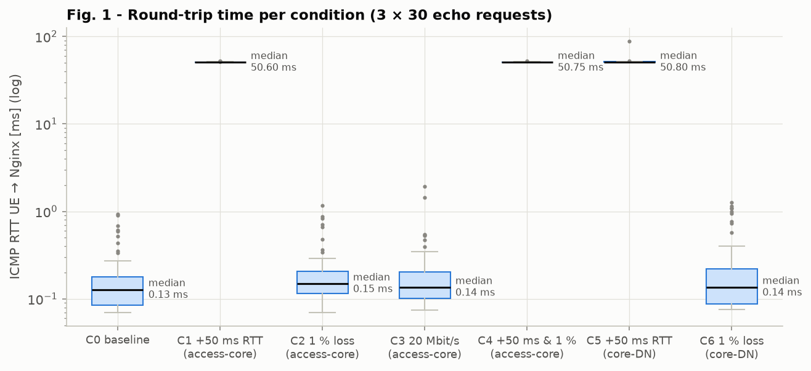
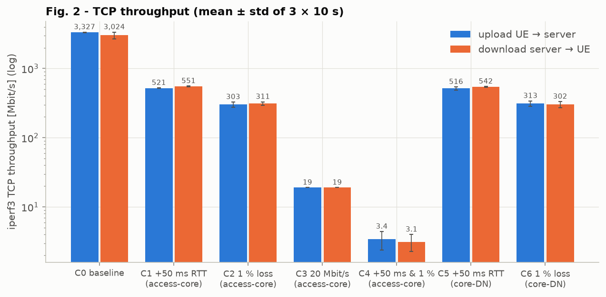
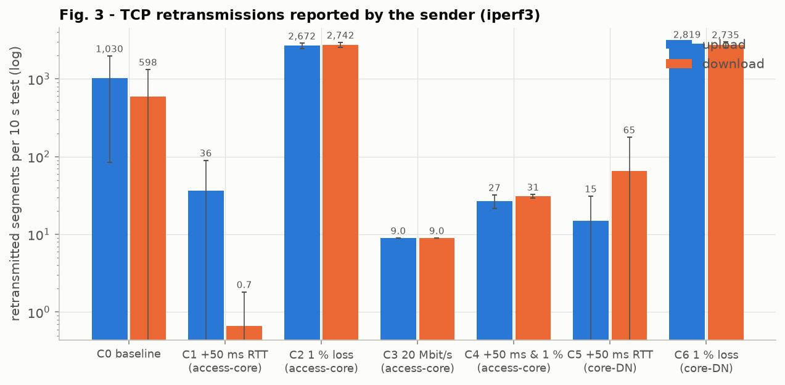
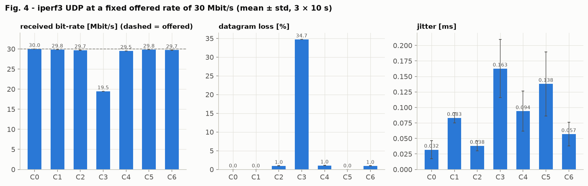
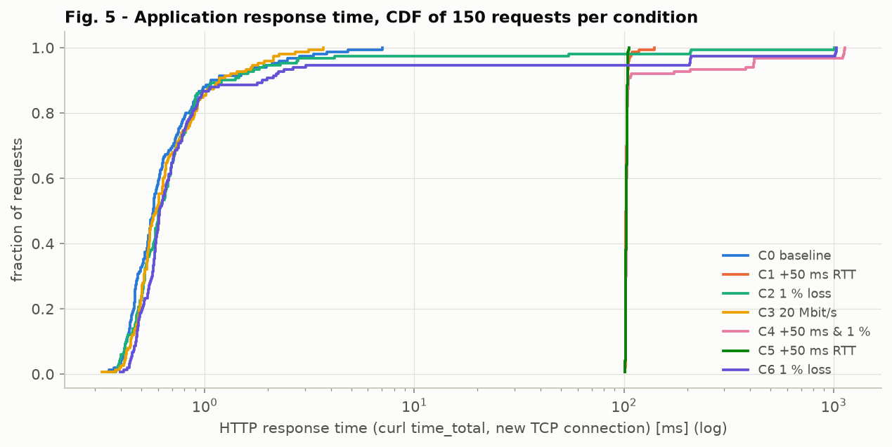
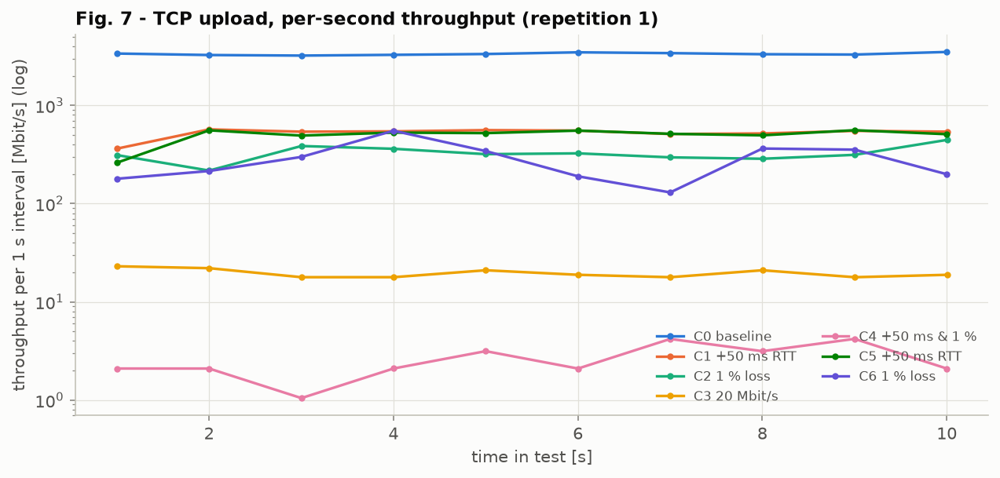

### 6.4 Interpretation - from configured condition to application impact

**C1 - +50 ms RTT.**

* *Network:* the RTT rises from 0.17 to 50.8 ms, i.e. by exactly the configured 2 × 25 ms.
* *Transport:* TCP throughput falls by 84 % to 521 Mbit/s although nothing is lost (0 lost segments in §6.5). Throughput ≤ window / RTT. The amount of data in flight is limited by the sender's socket buffer: `net.ipv4.tcp_wmem` max = 4 MiB, of which ≈ 3.6 MB is payload. 3.6 MB × 8 / 55.8 ms ≈ 520 Mbit/s, which matches the measurement. The receive buffer (`tcp_rmem` max 31 MB) is not the limit. The per-second throughput is flat (Fig. 7), as expected for a window-limited flow. The download direction behaves the same (551 Mbit/s), because the container has the same `tcp_wmem` limit.
* *UDP:* not affected in rate or loss (29.84 Mbit/s, 0 %), because it has no feedback loop. Only the jitter grows slightly (netem timer granularity).
* *Application:* a new HTTP connection needs one RTT for the handshake and one for request/response, so the median of 102 ms = 2 × RTT. The connect time (50.9 ms) is exactly one RTT. The 1 MiB object needs ≈ 9 RTT (460 ms) because slow start doubles cwnd from 10 segments once per RTT. Latency, not bandwidth, dominates short transfers.

**C2 - 1 % loss per direction.**

* *Network:* the ping loss is 3.3 % on average. With 30 samples per run this is very noisy. The expected round-trip loss is 1 − 0.99² = 2 %.
* *Transport:* TCP throughput falls by 91 % to ≈ 300 Mbit/s, while the RTT barely changes. Each loss is detected by SACK/duplicate ACKs, the segment is retransmitted (≈ 2,700 retransmissions per 10 s ≈ 1 % of the ≈ 260k segments sent), and CUBIC reduces cwnd by 30 % at each loss event. The result agrees with the Mathis et al. model B ≤ (MSS/RTT)·1.22/√p (`results/model_check.md`):

  | Condition | p | sRTT [ms] | Model bound [Mbit/s] | Measured [Mbit/s] |
  |---|---:|---:|---:|---:|
  | C2 1 % loss | 0.01 | 0.38 | 376.5 | 302.6 |
  | C4 +50 ms & 1 % | 0.01 | 52.06 | 2.7 | 3.4 |
  | C6 1 % loss (core-DN) | 0.01 | 0.44 | 321.7 | 312.8 |

* *UDP:* it loses exactly the configured share (0.95 % of ≈ 25.9k datagrams per test) and keeps sending at 30 Mbit/s. **UDP has no acknowledgement or retransmission mechanism**: lost datagrams are simply gone, and only the application (iperf3 sequence numbers) notices.
* *Application:* the HTTP median is unchanged (0.62 ms), because 97-98 % of requests lose nothing. The tail grows instead. A lost SYN is retransmitted only after the 1 s initial RTO, which gives the 1,000 ms outliers in Fig. 5. A lost last segment of a short response needs a tail-loss probe or RTO (≥ 200 ms), which is why the p95 of C6 is 77 ms. Availability is still 100 %, because TCP repairs the losses at the cost of latency.

**C3 - 20 Mbit/s token bucket.**

* *Transport:* TCP reaches **19.1 Mbit/s** in both directions. The tbf meters whole Ethernet frames (1514 B) while iperf3 counts TCP payload (1448 B), and 20 × 1448/1514 = 19.13 Mbit/s. The shortfall is protocol overhead, not a configuration error. There are very few retransmissions (9 per 10 s): the 50 ms tbf buffer absorbs the cwnd and the sender sRTT rises to 57 ms, which is bufferbloat. The latency of the bottleneck queue adds directly to the RTT seen by the flow.
* *UDP:* offered at 30 Mbit/s, UDP does **not** adapt. The bucket passes 19.46 Mbit/s (20 × 1448/1490) and drops the rest, so the loss is 34.7 % (expected 1 − 19.46/30 = 35.1 %).
* *Application:* the 1 MiB transfer takes 427 ms ≈ 8 Mbit / 19.1 Mbit/s (the bottleneck rate). The small page is unaffected (0.59 ms), because 700 bytes never fill the bucket.

**C4 - delay and loss combined.**

* *Transport:* the effects multiply, as the Mathis model predicts (throughput ∝ 1/(RTT·√p)). TCP drops to **3.4 Mbit/s** (−99.9 %). Each loss halves a window that can only grow by one segment per 50 ms RTT.
* *Application:* the 1 MiB transfer takes 1.2 s ± 0.5 s, and the HTTP p95 rises to 278 ms. The condition is the most damaging of all, although each impairment on its own is moderate.

### 6.5 Packet-level evidence for the measured degradation

For a 3 s TCP flow paced at 50 Mbit/s, the data segments were counted at P1 (sender) and P4 (after all
impaired links). Packets that the network dropped are visible as the difference
(`data/step3_packet_evidence.csv`, `captures/step3/*.pcap.gz`):

| Condition | Data segments at P1 | Data segments at P4 | Lost on path | Retransmissions (P1) | Dup ACKs (P1) | Mean ACK RTT at UE [ms] |
|---|---:|---:|---:|---:|---:|---:|
| C0 baseline | 13151 | 13151 | 0 | 39 | 17 | 0.47 |
| C1 +50 ms RTT | 13084 | 13084 | 0 | 0 | 1 | 51.22 |
| C2 1 % loss | 13249 | 13104 | 145 (1.09 %) | 149 | 206 | 1.05 |
| C3 20 Mbit/s | 5175 | 5168 | 7 (tbf drops) | 8 | 273 | 48.77 |
| C4 +50 ms & 1 % | 896 | 884 | 12 (1.3 %) | 11 | 70 | 50.70 |
| C5 +50 ms RTT (core-DN) | 13081 | 13081 | 0 | 0 | 1 | 52.14 |
| C6 1 % loss (core-DN) | 13177 | 13066 | 111 (0.84 %) | 122 | 159 | 0.38 |

* **C2/C6:** the number of segments that disappeared between P1 and P4 is approximately equal to the number of retransmissions. Duplicate ACKs precede each retransmission, so the measured throughput reduction is caused by real loss recovery. The netem counters for the whole C2 run agree (`results/raw/C2_loss1/qdisc_after.txt`): `acc-core` dropped 9,522 of 956,513 packets (0.996 %) and `core-acc` dropped 8,989 of 902,174 (0.996 %).
* **C1/C5:** there is no loss and no retransmission, but the **ACK RTT measured in the trace is 51-52 ms**. The throughput reduction is caused by RTT alone (window limit).
* **C3:** the 50 Mbit/s flow is held at 20 Mbit/s by the bucket: only 5175 segments in 3 s, ACK RTT 48.8 ms (queueing delay in the tbf), and some tail drops at the bucket. Over the whole C3 run the uplink tbf dropped 27,018 packets, almost all of them the UDP excess above 20 Mbit/s, and reported 343,050 *overlimits* (packets that had to wait for tokens).
* **C0:** there are 39 retransmissions **without any segment missing at P4**. They are spurious (§8.1).

### 6.6 Does the location of the impairment matter?

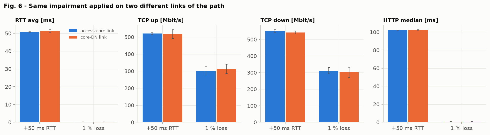

The same `delay 25ms` and `loss 1%` were applied to the **access-core** link (C1/C2) and to the
**core-DN** link (C5/C6). The end-to-end metrics agree within one standard deviation:

* RTT: 50.78 vs 51.34 ms
* TCP up: 521 vs 516 Mbit/s and 303 vs 313 Mbit/s
* HTTP median: 102.1 vs 102.4 ms

On a serial path without cross traffic, an end-to-end flow experiences the **sum** of the impairments
regardless of where they are. The location still matters for **diagnosis**, because the drop counters
increase only on the impaired link's qdisc:

| Run | `access/acc-core` | `core/core-acc` | `core/core-dn` | `host/host-core` |
|---|---:|---:|---:|---:|
| C2 (loss on access-core) | 9,522 dropped | 8,989 dropped | no qdisc | no qdisc |
| C6 (loss on core-DN) | no qdisc | no qdisc | 9,794 dropped | 8,864 dropped |

In Scenario B this distinction separates N3 (gNB-UPF) from N6 (UPF-DN). End-to-end measurements alone cannot localise a fault; per-segment counters or multi-point captures can.

---

## 7. Operational observability - Prometheus and Grafana

### 7.1 Measurement architecture

```
 UE / access / core namespaces, host, containers           (data sources - user plane untouched)
        │   ip -s -j link, tc -s -j qdisc, /proc/<pid>/net/snmp, nginx stub_status,
        │   active probes from the UE (ping + curl every 1 s)
        ▼
 exporter/scenario_exporter.py  :9101  ──scrape 1 s──►  Prometheus (10.0.5.30)  ──PromQL──►  Grafana (10.0.5.40)
```

The exporter runs in the host namespace. Prometheus reaches it through the observability bridge
(10.0.5.1), **never through the UE → server path**, so Prometheus and Grafana do not forward user
traffic and do not distort the measured path.

| Metric family | Source | Used for |
|---|---|---|
| `scena_iface_{rx,tx}_{bytes,packets}_total`, `scena_iface_dropped_total`, `scena_link_up` | `ip -s -j link` in each namespace | throughput per hop, link state |
| `scena_qdisc_drops_total`, `scena_qdisc_backlog_bytes`, `scena_impair_{delay_ms,loss_percent,rate_mbit}` | `tc -s -j qdisc` | where packets are dropped or queued, and which condition is active |
| `scena_tcp_retrans_segs_total{endpoint}` | `/proc/net/snmp` of the UE and of each container | TCP retransmissions on the sender side |
| `scena_probe_rtt_ms`, `scena_probe_icmp_{sent,lost}_total` | ping from netns `ue` every 1 s | RTT and loss |
| `scena_probe_http_seconds{phase}`, `scena_probe_http_up` | curl from netns `ue` every 1 s | application response time and availability |
| `scena_nginx_*` | Nginx `stub_status` | server-side request rate |

The Grafana dashboard (`deploy/grafana/provisioning/dashboards/scenario-a.json`, provisioned
automatically) has the panels required by the assignment:

1. Throughput
2. RTT
3. Packet loss and qdisc drops
4. TCP retransmissions
5. Path/service state (state timeline)
6. Application response time

It also shows the configured impairment and the Nginx request rate.

### 7.2 Timeline experiment

`scripts/07_timeline.sh` runs one long iperf3 TCP upload from the UE. The network condition changes
every 40-60 s while Prometheus records everything. `analysis/timeline.py` exports the series via the Prometheus HTTP API
(`/api/v1/query_range`, step 1 s) to `data/timeline_prometheus.csv` and plots Fig. 9.

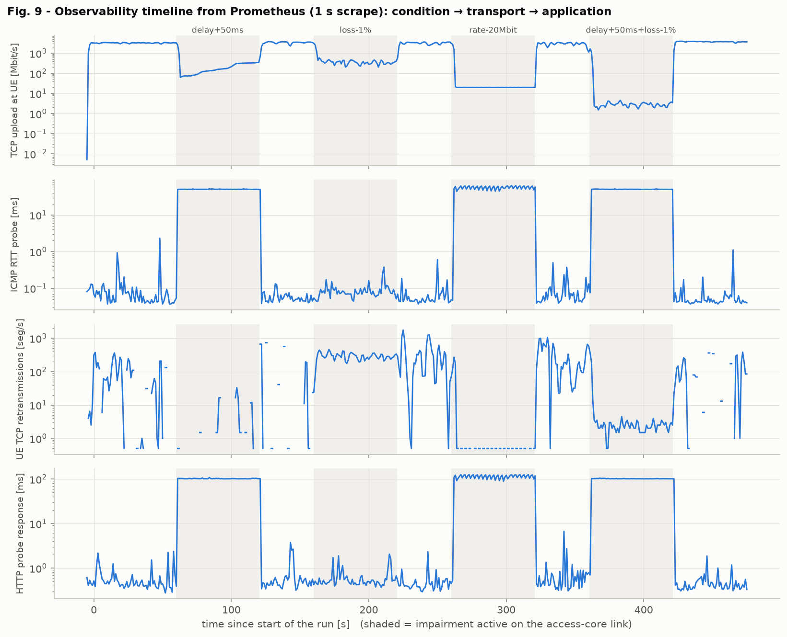

Per-phase summary from the Prometheus series (first 5 s of each phase skipped as transition;
`results/timeline/phase_summary.md`):

| Phase | Impairment (access-core link) | TCP up median [Mbit/s] | RTT probe median [ms] | UE TCP retrans/s | qdisc drops/s | HTTP probe median [ms] | HTTP availability |
|---|---|---:|---:|---:|---:|---:|---:|
| baseline | none | 3280 | 0.06 | 67.7 | 0 | 0.44 | 100 % |
| delay+50ms | netem delay 25ms | 164 | 50.50 | 2.5 | 0 | 101.86 | 100 % |
| recovery-1 | none | 3507 | 0.05 | 68.1 | 0 | 0.50 | 100 % |
| loss-1% | netem loss 1% | 350 | 0.08 | 290.0 | 309.5 | 0.50 | 100 % |
| recovery-2 | none | 3346 | 0.05 | 297.2 | 0 | 0.39 | 100 % |
| rate-20Mbit | tbf 20mbit | 20 | **58.30** | 0.3 | 0.3 | **117.93** | 100 % |
| recovery-3 | none | 3067 | 0.06 | 276.9 | 0 | 0.48 | 100 % |
| delay+50ms+loss-1% | netem delay 25ms loss 1% | 2.8 | 50.40 | 2.4 | 2.9 | 101.39 | 100 % |
| recovery-4 | none | 3752 | 0.04 | 78.8 | 0 | 0.40 | 100 % |

What the time series show (in addition to the Step 3 table):

* **Cause and effect are visible in time.** Every change of the tc configuration shows up in the RTT and HTTP probes within one scrape (1 s), and in the rate-based panels within the 3 s `rate()` window. When the impairment is removed, the metrics return to baseline within a few seconds. No state is left behind.
* **TCP history matters.** In C1 a *fresh* iperf3 flow reached 521 Mbit/s at +50 ms RTT. The *long-lived* flow in the timeline drops to ≈ 75 Mbit/s when the delay appears and then climbs only slowly, 74 → 334 Mbit/s in 60 s (median 164). Its congestion window was sized for a 0.3 ms RTT: ≈ 290 KB / 50 ms ≈ 50-75 Mbit/s. The flow is already in congestion avoidance (`ssthresh` was set by earlier loss/reordering events), so it grows by CUBIC's slow, time-based curve instead of slow start. The same network condition gives different throughput depending on the transport state of the flow.
* **Bufferbloat under load.** In C3 the 20 Mbit/s limit did not affect the (unloaded) ping RTT (0.20 ms). With a saturating TCP flow in the same bottleneck, the tbf queue stays full, and the 1 s ICMP probe sees a **median RTT of 58 ms** and the HTTP probe **118 ms**. The queueing delay of the bottleneck (latency 50 ms) is imposed on all traffic that shares it, including small, latency-sensitive requests that use almost no bandwidth.
* **Loss.** UE retransmissions (290 /s) and netem drops (310 /s on both directions together) move together, which confirms that the retransmissions in this phase repair real losses.
* **Reordering is visible as background noise.** In the baseline and recovery phases, Panel 4 shows 68-297 retransmissions/s without any impairment: the reordering effect diagnosed in §8.1.
* **Degradation is not failure.** HTTP availability stayed 100 % in every phase: the impairments degrade latency and throughput, but TCP keeps the service *available*. Only the faults in §8.2 break availability.

**Grafana dashboard** for the same run (rendered headless with `analysis/grafana_snapshot.py`):

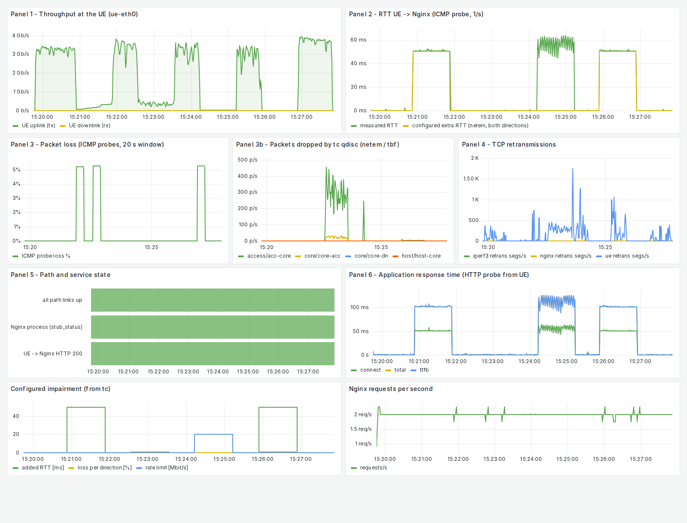

### 7.3 Purpose and limits of each observation method

| Method | What it shows | What it does **not** prove / limitation (example from this project) |
|---|---|---|
| `docker ps`, `docker compose ps` | container/process state | nothing about routes, forwarding or sockets: all containers were *Up* during F1 and F2 while the service was down |
| `ping` | L3 reachability and ICMP RTT of one path | not TCP/HTTP. In F3 the network was fine (ping 10.0.4.20 OK) but the application was down. In C3 the unloaded ping hid the bufferbloat. |
| `traceroute` | hop sequence via ICMP time-exceeded | a broken *return* path looks like a dead hop (F1: hop 3 `*` although the host forwarded the packets) |
| `tcpdump` / `tshark` | the exact packets at one interface: headers, flags, sequence numbers, timing | only at the chosen points. The capture itself can drop packets (the first Step 2 run wrote to a 9p mount). Packets dropped by an egress qdisc are not seen on that interface. Large volumes at Gbit/s rates. |
| `iperf3` | transport capacity, retransmissions, UDP loss/jitter at a controlled offered load | synthetic traffic. The retransmission count includes spurious ones (F0). One test at a time per server. |
| `curl` | what a client experiences: success, connect/TTFB/total time | one sample per request; says *that* it failed (exit 28), not *where* |
| kernel counters (`nstat`, `ip -s link`, `tc -s qdisc`, `softnet_stat`) | where packets are dropped or rejected (`IpInAddrErrors`, qdisc drops, DSACK) | cumulative and not per flow; needs a before/after delta |
| Prometheus | all of the above as time series (1 s), so changes can be correlated in time | sampling: events shorter than ~3 s are smoothed. Only as good as the exporter. Not in the data path. |
| Grafana | visual correlation of Prometheus series | produces no measurements of its own; not a network element |

---

## 8. Failure diagnosis (evidence chains)

Each case follows the chain **symptom → affected path/component → packet / system / application
evidence → measured impact → root cause → correction/recovery**. F0 was *found* during the baseline
measurements. F1-F3 were *injected* by `scripts/06_failure.sh`, while an HTTP probe ran from the UE
every 0.5 s and tcpdump captured at P1-P4 and on the host uplink `eth0`.

### 8.1 F0 - TCP retransmissions in the unimpaired baseline (found, not injected)

| Step | Evidence |
|---|---|
| **Symptom** | With **no impairment**, iperf3 reports 1030 ± 946 retransmissions per 10 s upload (Table 6.3). The count varies strongly between runs (CV 92 %), but throughput is stable at 3.3 Gbit/s. |
| **Hypothesis 1: kernel input-backlog overflow** | During the first tests the veth counters showed `rx_dropped` and `/proc/net/softnet_stat` showed drops, because `netdev_max_backlog` was 1000. Test (`08_baseline_retrans_diagnosis.sh` part A, `results/baseline_retrans/partA_backlog.csv`): 3 × 10 s uploads each with backlog 1000 and 10000 → **0 softnet drops in all six runs, but 258-2720 retransmissions in all of them**. Backlog overflow is therefore *not* the cause (the value stays at 10000 anyway, which prevents the earlier drops). |
| **Hypothesis 2: loss on the path vs reordering** | Part B captured a 3 s full-rate flow at P1 and P4 at the same time (0 capture drops): **704,296 data segments at P1 and 704,296 at P4**. The interface drop counters on all hops did not change. **Nothing was lost**, yet the sender retransmitted 47 segments. |
| **Packet evidence** | tshark classifies 47 segments as retransmissions at P1, but **445** at P4 for the identical set of packets. The extra ≈ 400 are original segments that arrive at P4 *after* higher-numbered segments, i.e. they were **reordered between P1 and P4**. |
| **System evidence (TCP MIB)** | Sender (UE): `TCPSACKReorder` = 97, `TCPDSACKRecv` = 12. Receiver (iperf3 container): `TCPOFOQueue` = 42 (segments placed in the out-of-order queue), `TCPDSACKOldSent` = 12. The receiver tells the sender, via **D-SACK (RFC 2883)**, that it received the retransmitted data twice, so those retransmissions were **spurious**. Part A shows the same pattern in every run: the receiver queued 219-1496 segments out of order and sent 153-966 D-SACKs, and the sender counted 235-1202 reordering events. |
| **Root cause** | A veth "transmits" by putting the packet on the input backlog of the CPU that executes the transmit, and NET_RX softirq processing continues there. A flow crosses four veth hops, and the sending thread and softirqs run on different CPUs over time. Packets of one flow can therefore be processed in parallel on two CPUs and overtake each other. The receiver sees a gap and sends duplicate ACKs with SACK blocks, and the sender's loss detection fires before the late segment arrives. Linux then detects the reordering (`TCPSACKReorder`) and widens its reordering window, which is why the count varies so much between runs. |
| **Impact** | Small: the retransmissions are ≈ 0.3-1 % of the segments, and throughput stays at 3.3 Gbit/s. However, a retransmission counter on its own would wrongly suggest a lossy baseline. |
| **Correction / lesson** | Not a configuration error but a property of the multi-CPU software data plane. In this report retransmission counts are interpreted **only together with packet evidence** (P1 vs P4 segment counts, §6.5): real loss in C2/C6 shows missing segments, while baseline retransmissions do not. An informal extra test with the sender pinned to one CPU (`taskset`) reduced the retransmissions in two of three runs, but not consistently, because reordering also happens on the receiver/ACK side. That test is not part of the saved dataset. |

### 8.2 Injected failures F1-F3

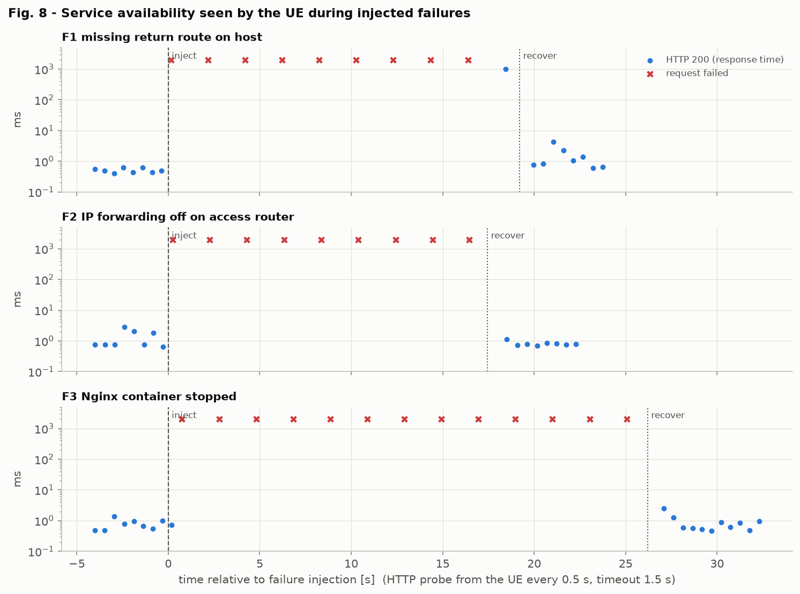

| Case | Availability before | Availability during | Availability after | First failed probe after injection | Time to first success after fix | curl error |
|---|---:|---:|---:|---:|---:|---|
| F1 missing return route on host | 100 % | 10 % ¹ | 100 % | 0.15 s | 0.75 s | 28 (timeout) |
| F2 IP forwarding off on access router | 100 % | 0 % | 100 % | 0.24 s | 1.04 s | 28 (timeout) |
| F3 Nginx container stopped | 100 % | 7 % ² | 100 % | 0.73 s | 0.88 s | 28 (timeout) |

¹ The single success inside the F1 window is a probe that started 0.8 s before the fix and completed through its 1 s SYN retransmission *after* the fix (response time 1.0 s in Fig. 8).
² In F3 the first probe after the stop command still succeeded, because `docker stop -t 1` takes up to one second to terminate Nginx.

#### F1 - Missing return route on the host (routing misconfiguration)

| Step | Evidence (`results/failure/F1_*`, `captures/failure/F1_*`) |
|---|---|
| **Injection** | `ip route del 10.0.1.0/24 via 10.0.3.1` on the host |
| **Symptom** | `curl` times out (exit 28, `code=000` after 2 s); ping to 10.0.4.10 gives 100 % loss. |
| **Misleading signals** | `docker ps` shows every container *Up*. Ping to the core (10.0.3.1) works. The forward path is intact. |
| **Localisation by hop** | Ping to the host (10.0.3.2) **fails** while ping to the core (10.0.3.1) succeeds, so the problem is at the host or beyond. Traceroute stops after hop 2 (`10.0.2.2`, then `* * *`). |
| **Packet evidence (multi-point)** | In the failure window the **40 SYNs** from the UE (including SYN retransmissions after 1 s, 3 s, ...) are seen at P1, P2, P3 *and* P4, and Nginx answers every one with a **SYN-ACK at P4**. **0 SYN-ACKs reach P3, P2 or P1.** The capture of the host's uplink `eth0` contains **93 SYN-ACKs** addressed to 10.0.1.10, so the replies leave through the wrong interface. |
| **System evidence** | `ip route get 10.0.1.10` on the host returns `via 192.168.192.1 dev eth0` (default route) instead of `via 10.0.3.1 dev host-core`. |
| **Root cause** | An asymmetric routing failure. The forward path works, but the return route for the UE prefix is missing, so the replies follow the default route out of the lab network. The same mechanism explains the traceroute `*` at hop 3: the host *does* send *ICMP time exceeded*, but towards `eth0`. |
| **Recovery** | Route re-added. The first new HTTP probe succeeded 0.75 s after the fix. |

#### F2 - IP forwarding disabled on the access router

| Step | Evidence |
|---|---|
| **Injection** | `ip netns exec access sysctl -w net.ipv4.ip_forward=0` |
| **Symptom** | `curl` times out (`code=000` after 2 s); ping to 10.0.4.10 gives 100 % loss. |
| **Misleading signals** | The access router itself still answers: ping 10.0.1.1 gives 0 % loss (0.06 ms). Links are UP, and the interface counters still increase on `acc-ue`. |
| **Packet evidence (multi-point)** | In the failure window P1 sees **36 SYNs** and 27 ICMP echo requests from the UE. **P2, P3 and P4 see none of them**: P2/P3 only contain 4 late SYN-ACK retransmissions travelling *towards* the UE (left over from F1), which also stop at the access router. The packet dies *inside* the access router, between `acc-ue` and `acc-core`, in both directions. |
| **System evidence** | `sysctl net.ipv4.ip_forward = 0` in `access`. `nstat` in `access` over the failure window: **`IpInReceives` = 52, `IpInAddrErrors` = 49, `IpForwDatagrams` = 0**. The kernel received datagrams that were not addressed to it and, with forwarding disabled, counted them as address errors and dropped them silently (no ICMP is sent back). |
| **Root cause** | The node had lost its router function: a configuration/state error, not a link failure. |
| **Recovery** | `ip_forward=1`. The first new HTTP probe succeeded 1.04 s after the fix. |

#### F3 - Application container stopped (service failure on a healthy network)

| Step | Evidence |
|---|---|
| **Injection** | `docker stop scena-nginx` |
| **Symptom** | `curl: (28) Connection timed out after 5002 ms`. A timeout, not "connection refused". |
| **Network health check** | Ping to the **iperf3 container 10.0.4.20 works** (0 % loss, TTL 61), so the whole L3 path UE → data network is healthy. Ping to 10.0.4.10 gives 100 % loss. The fault is local to one endpoint. |
| **Packet evidence** | P1, P2 and P3 carry identical traffic (121 packets, 63 SYNs). The SYNs reach P4 (the Docker bridge), but after the first two connections (made while Nginx was still shutting down) **no SYN-ACK and no RST come back**: no process and no interface owns 10.0.4.10 any more. P4 shows extra SYNs that the host itself sends to Nginx (the exporter's `stub_status` poll from 10.0.4.1). **No ARP request for 10.0.4.10 appears** in the whole failure window. |
| **System evidence** | `docker ps -a`: `scena-nginx Exited (0)`. `docker network inspect scena-dn` lists only `scena-iperf3`. The host neighbour table still shows `10.0.4.10 lladdr 86:a4:bc:4b:9a:50 REACHABLE`: a **stale neighbour entry**. The host keeps sending frames to the MAC of the vanished container. The bridge no longer knows that MAC, so it floods the frames to the remaining port, where they are discarded. This explains why the client gets a silent **timeout** instead of a fast *ICMP host unreachable*, which would only appear after the neighbour entry expired and ARP resolution failed. |
| **Root cause** | The application endpoint is down, while the network, routing and the other services are fine. Container state (`docker ps`) is the decisive evidence here, but it does not explain the client-side symptom; the packet and neighbour evidence does. |
| **Recovery** | `docker start scena-nginx` (and offloads re-applied on the new veth). The new container announces itself with gratuitous ARP (new MAC `62:c8:25:...`), and the first new HTTP probe succeeded 0.88 s after the start command. |

**Lessons.**

* A healthy `docker ps` (F1, F2) and a successful ping to the next hop (F1, F2) are **not** proof of a working service path.
* Comparing captures at several points locates the failure at a specific segment:
  * F1: P4 sees the reply, P3 does not → the host's routing;
  * F2: P1 sees the request, P2 does not → the access router;
  * F3: P4 sees the request but there is no answer → the endpoint.
* Kernel counters (`IpInAddrErrors`) and routing lookups (`ip route get`) then confirm the root cause.

---

## 9. Data pipeline and repository layout

```
DE0849-Project1-ScenarioA/
├── README.md                    this report
├── requirements.txt             Python packages (numpy, pandas, matplotlib, prometheus_client, ...)
├── deploy/
│   ├── docker-compose.yml       nginx, iperf3, prometheus, grafana + networks scena-dn / scena-obs
│   ├── nginx/                   Dockerfile, default.conf, index.html (application server image)
│   ├── prometheus/prometheus.yml
│   └── grafana/provisioning/    datasource + dashboard (scenario-a.json)
├── scripts/
│   ├── lib.sh                   addressing plan and helpers (single source of truth)
│   ├── 00_install.sh            packages and images
│   ├── 01_deploy.sh             namespaces, veths, routes, forwarding, Docker, offloads
│   ├── 02_verify.sh             Step 1 evidence
│   ├── 03_capture.sh            Step 2 multi-point captures + tshark decoding
│   ├── impair.sh                tc netem/tbf apply | clear | show
│   ├── 04_measure.sh            one condition: ping, iperf3 TCP/UDP, HTTP, evidence capture
│   ├── 05_experiments.sh        all conditions C0-C6
│   ├── 06_failure.sh            injected failures F1-F3
│   ├── 07_timeline.sh           Prometheus/Grafana timeline run
│   ├── 08_baseline_retrans_diagnosis.sh   diagnosis F0
│   ├── run_all.sh / 99_teardown.sh
├── exporter/scenario_exporter.py    Prometheus exporter
├── analysis/                    parse_results.py, analyze.py, step2_analysis.py, failure_analysis.py,
│                                timeline.py, grafana_snapshot.py, plotstyle.py
├── results/                     raw outputs (step1/, raw/<condition>/, failure/, baseline_retrans/, timeline/)
│                                + generated tables (summary_table.md, model_check.md, packet_evidence_table.md)
├── captures/                    step2/*.pcap (+ analysis/), step3/*.pcap.gz, failure/*.pcap.gz
├── data/                        structured dataset (CSV) produced by the analysis
└── figures/                     all plots used in this report
```

**Dataset** (`data/`):

| File | Content |
|---|---|
| `measurements.csv` | condition, link, spec, rep, layer, metric, value, unit |
| `ping_samples.csv` | every RTT sample |
| `http_requests.csv` | every curl request with timing and status |
| `iperf_intervals.csv` | per-second throughput, retransmissions, cwnd, sRTT |
| `summary.csv` | mean, std, min, max, n and CV per condition and metric |
| `step3_packet_evidence.csv` | tshark counters from the evidence captures |
| `timeline_prometheus.csv` | the exported Prometheus series |

All `.pcap` files open directly in Wireshark (`.pcap.gz` included).

---

## 10. Known limitations

* **Single host, virtual links.** All "links" are veth pairs that copy memory, so the absolute throughput (3.3 Gbit/s) is a CPU limit of the 4-vCPU WSL2 VM, not a link rate. The relative changes between conditions are the meaningful result.
* **CPU-bound baseline.** With offloads disabled, a single TCP flow saturates one core. The baseline also contains reordering-induced spurious retransmissions (§8.1), so retransmission *counts* are compared between conditions together with packet evidence, not as absolute values.
* **netem is a model.** Loss is independent (Bernoulli) and delay is constant. Real links show bursty loss and variable delay. Only 1 % loss and 50 ms were studied, with 3 repetitions each. Ping loss estimates from 30 probes have a large confidence interval.
* **WSL2 specifics.** The kernel modules for netem/tbf come from the WSL module VHD. Docker runs inside WSL2 (not Docker Desktop). Writing captures directly to the Windows filesystem (9p) caused tcpdump drops, so the scripts capture to `/tmp` first and copy afterwards.
* **Prometheus resolution.** The scrape interval is 1 s and rates use a 3 s window, so events shorter than ~3 s are smoothed. The packet captures remain the authoritative source for short events.
* **Probe traffic** from the exporter (1 ping and 1 HTTP request per second) shares the path with the measured flows during the timeline run. It is negligible in volume but is visible in the Nginx request rate.

---

## 11. References

1. Project 1 assignment: *Network Deployment, Measurement, and Observability*, DE0849, RTU, 2026.
2. Lecture slides DE0849 *Telecommunications Software 02* (Linux, kernel, Docker tools) and *Introduction to Docker*.
3. `ip-netns(8)`, `veth(4)`, `tc-netem(8)`, `tc-tbf(8)` - Linux manual pages.
4. Docker documentation - *Bridge network driver*, `gateway_mode_ipv4` option.
5. M. Mathis, J. Semke, J. Mahdavi, T. Ott, "The macroscopic behavior of the TCP congestion avoidance algorithm", *ACM SIGCOMM CCR*, 27(3), 1997.
6. RFC 9293 (TCP), RFC 2883 (D-SACK), RFC 8985 (RACK-TLP), RFC 768 (UDP), RFC 792 (ICMP), RFC 9110/9112 (HTTP).
7. iperf3, Wireshark/TShark, Prometheus and Grafana documentation.
