# Project 1 - Network Deployment, Measurement and Observability (Scenario B: 5G SA)

← [Project 1 overview](../README.md) · [Scenario A](../scenario-a/README.md)

**Author:** Vasif Yusifli, 261AEM001
**Course:** DE0849 Telecommunications Software - Riga Technical University (2026/27)
**Scenario:** B - Advanced software-based 5G Standalone network (UERANSIM + Open5GS + Docker)

Scenario B runs the same Deploy → Verify → Observe → Measure → Diagnose → Explain workflow as
Scenario A, on a real 5G SA protocol stack:

* a software UE and gNB;
* 5G registration with 5G-AKA authentication;
* a PDU session;
* separate control-plane (N2/NGAP, N4/PFCP, SBI/HTTP2) and user-plane (N3/GTP-U, N6) interfaces;
* operational telemetry from the 5G core.

The measurement methodology (repetitions, metrics, tc/netem, dataset format) is the same as in
Scenario A, so the two reports can be compared directly.

---

## Contents

1. [Key findings](#1-key-findings)
2. [Architecture](#2-architecture)
3. [Reproduction](#3-reproduction)
4. [Step 1 - Deployment and end-to-end operation](#4-step-1---deployment-and-end-to-end-operation)
5. [Step 2 - Traffic observation and 5G protocol behaviour](#5-step-2---traffic-observation-and-5g-protocol-behaviour)
6. [Step 3 - Performance, degradation and N3 versus N6](#6-step-3---performance-degradation-and-n3-versus-n6)
7. [Operational observability - Prometheus and Grafana](#7-operational-observability---prometheus-and-grafana)
8. [Failure diagnosis](#8-failure-diagnosis)
9. [Repository layout and limitations](#9-repository-layout-and-limitations)

---

## 1. Key findings

| # | Finding | Evidence |
|---|---|---|
| 1 | All 10 core NFs register in the NRF. The gNB has an SCTP association with the AMF (NG Setup successful). The UE is `RM-REGISTERED` with PDU session 1 `PS-ACTIVE` (10.45.0.x on `uesimtun0`). The UE reaches Nginx through the UPF (traceroute `10.45.0.1 → 10.20.6.20`), and Nginx logs the UE's own address. | §4 |
| 2 | One complete registration + PDU session takes **≈ 310 ms**. It involves N2 (11 NGAP messages carrying NAS), ≈ 25 SBI HTTP/2 requests via the SCP (AUSF, UDM, UDR, PCF, BSF, SMF) and 4 PFCP messages. All three were captured and correlated on one time axis. | §5.1 |
| 3 | The same user packets appear on `uesimtun0`, N3 and N6 (10 ICMP / 12 HTTP / 930 UDP each). On N3 every packet carries **+44 bytes** (outer IPv4 20 + UDP 8 + GTP-U 8 + PDU Session Container 8) and a TEID. The TEIDs match the F-TEID / Outer Header Creation values that the SMF installed over PFCP. | §5.3 |
| 4 | Baseline over the full 5G user plane: RTT **1.67 ms**, TCP **435 / 440 Mbit/s**, UDP 30 Mbit/s with 0 % loss, HTTP 2.3 ms. This is ~10× the latency and 1/8 of the throughput of Scenario A, because the gNB, UE and UPF forward every packet in user space. | Table 6.2 |
| 5 | **20 Mbit/s on N3 → 18.5 Mbit/s TCP = 20 × 1348/1458.** The token bucket counts the GTP-U-encapsulated frame (1458 B) while TCP delivers 1348 B of payload, so the encapsulation overhead is directly measurable. UDP at 30 Mbit/s loses 36.9 % (expected 37.3 %). | §6.3 |
| 6 | **N3 vs N6:** the same impairment gives the same end-to-end result on either segment (RTT 52.9 vs 52.6 ms, TCP 108 vs 103 Mbit/s at 1 % loss). Only the **multi-point capture** tells where it happened: with N3 loss the segments disappear *before* the N3 capture point, with N6 loss *between* N3 and N6. | §6.4, Fig. 6 |
| 7 | With +50 ms RTT, TCP drops to **21-32 Mbit/s** (Scenario A: 521). The packet evidence shows segments missing between N3 and N6 although netem only delays: the user-space **UPF itself drops packets** when large windows arrive in bursts. | §6.3 |
| 8 | Failures were diagnosed with logs + NAS/PFCP/GTP-U captures + NF metrics: **F1** wrong subscriber key → *Authentication failure (MAC failure, cause #20)*; **F2** UPF crash → SMF heartbeat detection after ≈ 14 s, automatic **PFCP session restoration** 12.5 s after restart; **F3** N3 link down → GTP-U black hole while N2 and N4 stay healthy. | §8 |

---

## 2. Architecture

### 2.1 Topology and interfaces

Every 5G reference point is a separate Docker bridge with its own subnet, following the reference
architecture of the assignment. That makes each interface observable on its own:

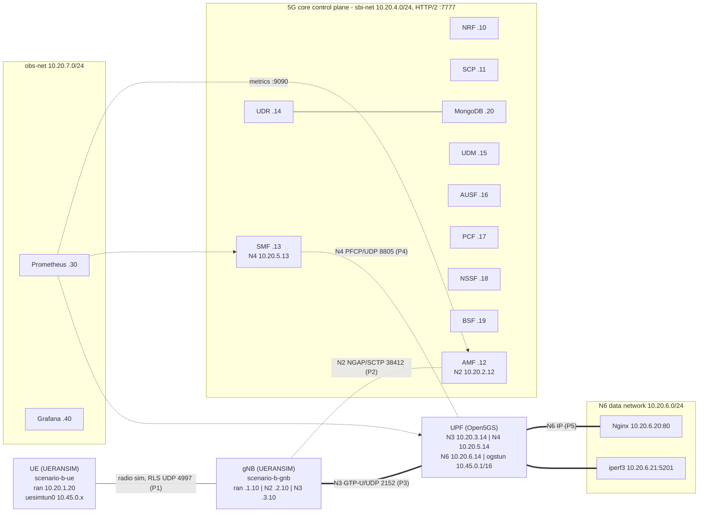

| Network (Linux bridge) | Subnet | Reference point / purpose | Members (IP) |
|---|---|---|---|
| `scenario-b-ran` (`br-ran`) | 10.20.1.0/24 | simulated NR radio (UERANSIM RLS) | UE .20, gNB .10 |
| `scenario-b-n2` (`br-n2`) | 10.20.2.0/24 | **N2** NGAP over SCTP 38412 | gNB .10, AMF .12 |
| `scenario-b-n3` (`br-n3`) | 10.20.3.0/24 | **N3** GTP-U over UDP 2152 | gNB .10, UPF .14 |
| `scenario-b-sbi` (`br-sbi`) | 10.20.4.0/24 | service-based interface, HTTP/2 :7777 | NRF .10, SCP .11, AMF .12, SMF .13, UDR .14, UDM .15, AUSF .16, PCF .17, NSSF .18, BSF .19, MongoDB .20, Prometheus .30 |
| `scenario-b-n4` (`br-n4`) | 10.20.5.0/24 | **N4** PFCP over UDP 8805 | SMF .13, UPF .14, Prometheus .30 |
| `scenario-b-dn` (`br-n6`) | 10.20.6.0/24 | **N6** data network | UPF .14, Nginx .20, iperf3 .21 |
| `scenario-b-obs` (`br-obs7`) | 10.20.7.0/24 | observability only | Prometheus .30, Grafana .40, host exporter .1:9102 |
| PDU session pool | 10.45.0.0/16 | UE addresses (`ogstun` 10.45.0.1 in the UPF) | UE `uesimtun0` |

**Identities:**

* PLMN 001/01, TAC 1, S-NSSAI SST 1, DNN `internet`.
* Subscriber IMSI 001010000000001, provisioned by `deploy/mongodb/add_subscriber.js` (K/OPc, AMBR 1 Gbps, 5QI 9).

**Images:**

* `gradiant/open5gs:2.8.0`, `gradiant/ueransim:3.3.0`, `mongo:7.0`;
* Nginx (custom image), `networkstatic/iperf3`;
* Prometheus 2.53, Grafana 11.2.

### 2.2 Design decisions

| Decision | Reason |
|---|---|
| One Docker network per reference point | N2, N3, N4, N6 and SBI can be captured separately on their bridges (`br-n2` ...), so a packet's interface is never ambiguous. |
| **No NAT in the UPF** (`ENABLE_NAT=false`), DN containers route 10.45.0.0/16 via 10.20.6.14 | The data network sees the real UE address 10.45.0.x, which proves that a request came through the PDU session. |
| UE test traffic runs **inside the UE network namespace** with route `10.20.6.0/24 dev uesimtun0` | All tests use the 5G user plane. Without the route, the UE container could reach the DN through Docker (the "Alpine → Nginx" trap described in the assignment). |
| NAS ciphering order `NEA0, NEA1, NEA2` | NAS messages stay readable in the lab captures after Security Mode Command (integrity: 128-5G-IA2). This would not be acceptable in production. |
| Open5GS configs use explicit addresses, logs go to stdout | `docker logs` gives the NF evidence; the configs document the IP plan. |
| UPF `privileged`, `/dev/net/tun` | It creates `ogstun` and writes sysctls (the PDF's "UPF TUN and networking" note). |
| Offloads off on the N3/N6 ports and DN containers, `netem limit 10000` | Same reasoning as Scenario A §2.3: every skb is one wire-size packet for tc/netem. |

---

## 3. Reproduction

```bash
cd DE0849-Project1/scenario-b
sudo ./scripts/00_install.sh      # packages, images, Python venv (/opt/p1venv)
sudo ./scripts/run_all.sh         # everything below (~35 min)
```

| Stage | Script | Output |
|---|---|---|
| Deploy | `01_deploy.sh` | MongoDB + subscriber → 5GC, UPF, gNB, UE, DN, Prometheus/Grafana → routes |
| Verify (Step 1) | `02_verify.sh` | `results/step1/` |
| Observe (Step 2) | `03_capture.sh` + `analysis/step2_analysis.py` | `captures/step2/`, `results/step2_logs/` |
| Measure (Step 3) | `05_experiments.sh 3` (uses `impair.sh`, `04_measure.sh`) | `results/raw/`, `captures/step3/` |
| Diagnose | `06_failure.sh` | `results/failure/`, `captures/failure/` |
| Observability | `07_timeline.sh` | Prometheus (127.0.0.1:9091), Grafana (127.0.0.1:3001), `results/timeline/` |
| Analyse | `analysis/*.py` | `data/`, `figures/`, `results/*.md` |
| Manual impairment | `impair.sh apply n3\|n6 netem delay 25ms`, `impair.sh clear` | |

---

## 4. Step 1 - Deployment and end-to-end operation

Evidence: `results/step1/`, produced by `02_verify.sh`.

**Control plane is up:**

* **NRF** (`GET /nnrf-nfm/v1/nf-instances` + one GET per instance): AMF, AUSF, BSF, NRF, NSSF, PCF, SCP, SMF, UDM and UDR are all `REGISTERED`, each with its SBI address 10.20.4.x.
* **N2:** `ss --sctp` in the AMF shows `LISTEN 10.20.2.12:38412` and `ESTAB 10.20.2.12:38412 ↔ 10.20.2.10:43308`, the same association seen from the gNB. gNB log: `SCTP connection established` → `NG Setup procedure is successful`. `nr-cli status`: `is-ngap-up: true`.
* **N4:** the SMF log shows `PFCP associated [10.20.5.14]:8805`. Sockets: SMF `10.20.5.13:8805`, UPF `10.20.5.14:8805`.
* **UE** (`nr-cli status`): `RM-REGISTERED`, `MM-REGISTERED/NORMAL-SERVICE`, `5U1-UPDATED`, PLMN 001/01, 5G-GUTI assigned. `nr-cli ps-list`: PDU Session 1 `PS-ACTIVE`, IPv4, DNN internet, SST 1, AMBR 1 Gbps up/down.
* **Core metrics:** AMF `gnb 1`, `ran_ue 1`, `amf_session 1`, `fivegs_amffunction_rm_reginitsucc` incremented. SMF `ues_active 1`, `pfcp_sessions_active 1`. UPF `fivegs_upffunction_upf_sessionnbr 1`.

**User plane is up:**

* UE: `uesimtun0 10.45.0.x/16`, MTU 1400 (from the SMF `mtu: 1400`), route `10.20.6.0/24 dev uesimtun0`.
* UPF: `eth1 10.20.3.14` (N3), `eth2 10.20.5.14` (N4), `eth0 10.20.6.14` (N6), `ogstun 10.45.0.1/16`, `ip_forward=1`. The kernel route `10.45.0.0/16 dev ogstun` sends downlink traffic into the UPF process.
* User-plane sockets: gNB `10.20.3.10:2152` and UPF `10.20.3.14:2152` (GTP-U), gNB `10.20.1.10:4997` (radio simulation).

**End to end, from the PDU session:**

| Test | Result |
|---|---|
| `ping 10.20.6.20` / `10.20.6.21` | 0 % loss, RTT avg 1.8 / 1.5 ms, TTL 63 (one routed hop: the UPF) |
| `traceroute 10.20.6.20` | `1 10.45.0.1` (UPF ogstun) → `2 10.20.6.20`. The gNB and N3 are invisible to IP because they are a tunnel. |
| `curl -v http://10.20.6.20/` | `HTTP/1.1 200 OK` from `10.20.6.20:80`, local address **10.45.0.12**, connect 1.3 ms, total 2.3 ms |
| Nginx access log | `10.45.0.12:37828 -> 10.20.6.20:80 "GET / HTTP/1.1" 200 400` |
| `iperf3 -c 10.20.6.21 -t 3` | 279 Mbit/s, local 10.45.0.x |
| **Contrast:** `curl` from inside the DN (iperf3 container) | also `200`, but from `10.20.6.21`. This proves only N6/Docker connectivity, **not** the 5G path. |

---

## 5. Step 2 - Traffic observation and 5G protocol behaviour

`03_capture.sh` captures simultaneously on `br-ran` (P1), `uesimtun0` inside the UE (P1, inner IP),
`br-n2` (P2), `br-n3` (P3), `br-n4` (P4), `br-n6` (P5-P7) and `br-sbi` (SBI). It then:

1. deregisters and powers off the UE (`nr-cli deregister switch-off`, outside the window);
2. powers the UE on, so the window contains one clean **initial registration + PDU session establishment**;
3. sends ICMP, HTTP, iperf3 TCP (20 Mbit/s, 2 s) and iperf3 UDP (5 Mbit/s, 2 s) through the PDU session.

0 packets were dropped by the capture. The NF logs of the same window are in `results/step2_logs/`.

### 5.1 Registration and PDU session - one timeline across N2, SBI and N4

`analysis/step2_analysis.py` merges the decoded NGAP/NAS, HTTP/2 and PFCP traces (tshark with
`nas-5gs.null_decipher` because NEA0 is used). The full table is in `captures/step2/analysis/procedure_timeline.md`;
these are the key rows (t = 0 at the Registration request):

| t [ms] | Interface | From → To | Message |
|---:|---|---|---|
| 0.0 | N2 | gNB → AMF | InitialUEMessage, **Registration request** (SUCI, null scheme) |
| 5.7 | SBI | AMF → SCP → AUSF | `POST /nausf-auth/v1/ue-authentications` |
| 17.3 | SBI | AUSF → SCP → UDM | `POST /nudm-ueau/v1/suci-…/security-information/generate-auth-data` → 200 |
| 20.4 | SBI | UDM → SCP → UDR | `GET /nudr-dr/v1/subscription-data/imsi-…/authentication-data/authentication-subscription` → 200 |
| 35.9 | N2 | AMF → gNB | DownlinkNASTransport, **Authentication request** (RAND, AUTN, ngKSI 3, ABBA) |
| 37.6 | N2 | gNB → AMF | UplinkNASTransport, **Authentication response** (RES*) |
| 38.0 | SBI | AMF → SCP → AUSF | `PUT …/ue-authentications/5/5g-aka-confirmation` → 200 |
| 48.0 | N2 | AMF → gNB | **Security mode command** (5G-EA0, 128-5G-IA2) |
| 49.2 | N2 | gNB → AMF | **Security mode complete** + Registration request (integrity protected and ciphered) |
| 49.8-56.3 | SBI | AMF → SCP → UDM → UDR | UECM `registrations/amf-3gpp-access`, SDM `am-data`, `smf-select-data`, `ue-context-in-smf-data` |
| 58.5 | SBI | AMF → SCP → PCF (→ UDR) | `POST /npcf-am-policy-control/v1/policies` |
| 69.2 | N2 | AMF → gNB | InitialContextSetupRequest, **Registration accept** |
| 273.0 | N2 | gNB → AMF | **Registration complete** + UL NAS transport, **PDU session establishment request** (DNN internet) |
| 274.5 | SBI | AMF → SCP → SMF | `POST /nsmf-pdusession/v1/sm-contexts` |
| 281.4-288.8 | SBI | SMF → UDM / PCF → UDR, BSF | `sm-data`, `sdm-subscriptions`, `npcf-smpolicycontrol/v1/sm-policies`, `nbsf-management/v1/pcfBindings` |
| 299.0 | **N4** | SMF → UPF | **PFCP Session Establishment Request** |
| 301.5 | N4 | UPF → SMF | PFCP Session Establishment Response |
| 303.6 | SBI | SMF → SCP → AMF | `POST /namf-comm/v1/ue-contexts/imsi-…/n1-n2-messages` (N1 accept + N2 resource setup) |
| 305.1 | N2 | AMF → gNB | **PDUSessionResourceSetupRequest** + **PDU session establishment accept** (PDU address 10.45.0.12) |
| 308.4 | N2 | gNB → AMF | PDUSessionResourceSetupResponse (gNB N3 F-TEID) |
| 313.2 | N4 | SMF → UPF | **PFCP Session Modification Request** (downlink FAR → gNB TEID) |
| 314.3 | SBI | SMF → SCP → UDM | UECM `smf-registrations/1` |

Interpretation:

* **Which NFs take part in registration?** UE, gNB, AMF; AUSF, UDM and UDR for 5G-AKA and the subscription data (UDR reads MongoDB); PCF for the access policy. The NRF is not in the timeline because discovery results are cached and the SCP does *indirect communication* (every request carries `→ SCP →`). NRF traffic appears only as NF registration and 10 s heartbeats (`PATCH /nnrf-nfm/v1/nf-instances/{id}`).
* **Why N2 is control plane.** N2 carries only NGAP procedures (UE context, PDU session resources) and NAS messages for the UE inside `InitialUEMessage`, `Uplink/DownlinkNASTransport` and `InitialContextSetup`. There are 11 NGAP messages in total and no user payload. User data never touches the AMF.
* **SBI does not carry user payload.** All ≈ 25 HTTP/2 requests are service operations (authentication vectors, subscription data, policies, SM context, N1/N2 message transfer). `captures/step2/analysis/sbi_interactions.md` groups them by consumer → producer → service.
* **How a PDU session becomes forwarding state.** The PDU session request goes AMF → SMF. The SMF gets SM data from the UDM and a policy from the PCF, then installs **PDRs and FARs** in the UPF over PFCP. The decoded Session Establishment request contains:
  * PDR 1: Source Interface **Core**, UE IP address 10.45.0.12 (downlink match), FAR 1;
  * PDR 2: Source Interface **Access**, F-TEID allocated by the UPF, QFI 1, **Outer Header Removal GTP-U/UDP/IP** (uplink decapsulation), FAR 2.

  After the gNB answers the PDUSessionResourceSetup with its own N3 tunnel endpoint, the SMF sends **Session Modification: Update FAR 1 → Outer Header Creation GTP-U/UDP/IPv4, TEID 0x0000000b, 10.20.3.10**. Only now can downlink packets be tunnelled to the gNB, and the UE has `uesimtun0` with 10.45.0.12.
* The 200 ms between InitialContextSetupResponse and Registration complete are spent inside the UERANSIM UE (internal timer), not in the network.

### 5.2 Per-interface view of the same user traffic

| Capture | All packets | ICMP | HTTP (tcp/80) | iperf3 UDP |
|---|---:|---:|---:|---:|
| P1 `uesimtun0` (inside UE) | 6284 | 10 | 12 | 930 |
| P1 `br-ran` (radio simulation) | 6333 | 0 | 0 | 0 |
| P2 N2 | 18 | 0 | 0 | 0 |
| P3 N3 | 6282 | 10 | 12 | 930 |
| P4 N4 | 78 | 0 | 0 | 0 |
| P5 N6 | 6276 | 10 | 12 | 930 |
| SBI | 371 | 0 | 0 | 0 |

The user traffic appears with identical counts on the UE tunnel, N3 and N6, and **never** on N2, N4 or the SBI.
On `br-ran`, the same packets are carried inside UERANSIM's proprietary RLS protocol (UDP 4997, one UDP
conversation of 6078 frames), so tshark cannot see IP/ICMP there. The "air interface" is simulated.

### 5.3 N3 / GTP-U encapsulation versus N6

One ICMP echo request (`captures/step2/analysis/n3_gtpu_packet_verbose.txt`):

| Layer | On N3 (P3) | On N6 (P5) |
|---|---|---|
| Outer IPv4 | 10.20.3.10 → 10.20.3.14, total length **128** | - |
| UDP | 2152 → 2152 | - |
| GTP-U | TEID **0x0000085f** (uplink, UPF-allocated), extension header **PDU Session Container: UL PDU SESSION INFORMATION, QFI 1** | - |
| Inner IPv4 | 10.45.0.12 → 10.20.6.20, total length **84**, TTL 64 | 10.45.0.12 → 10.20.6.20, length 84, **TTL 63** |
| ICMP | echo request seq 1 | echo request seq 1 |

* The reply travels on N3 with **TEID 0x0000000b**, the value the SMF configured in the FAR's Outer Header Creation (§5.1). The TEIDs are different per direction because each end allocates the TEID on which *it* receives.
* The encapsulation overhead is 128 − 84 = **44 bytes per packet**. The N3 capture carries 7.0 MB versus 6.7 MB on N6 for the same flows.
* The inner TTL is decremented only once (64 → 63), by the UPF. The UPF is the only IP router of the path; the gNB forwards inside the tunnel.
* A packet on N6 is the plain inner packet, so the same application traffic **looks different on N3 and on N6**, exactly as the assignment's "attention traps" warn.

**TCP / UDP / HTTP behaviour:**

* **HTTP (N6 trace):** SYN → SYN/ACK → ACK, `GET / HTTP/1.1`, `HTTP/1.1 200 OK` (Server nginx/1.27.5, 400 bytes), FIN exchange. The curl timing is connect 5.1 ms, total 9.5 ms on the first request (this includes ARP/route warm-up in the UE namespace); later requests take ≈ 2 ms.
* **TCP (iperf3):** a control connection and a data connection, both through GTP-U. The TCP MSS is limited by the PDU-session MTU of 1400 (1348 B payload with timestamps). 20.4 Mbit/s for 2 s.
* **UDP (iperf3 5 Mbit/s):** 928 datagrams, 0 lost, jitter 0.48 ms. There are no ACKs or retransmissions in UDP. The loss is counted only by iperf3's sequence numbers, and the three capture points agree (930 = 928 data + 2 control datagrams).

---

## 6. Step 3 - Performance, degradation and N3 versus N6

### 6.1 Conditions and procedure

| ID | Segment | tc on both ends of the segment | Intended effect |
|---|---|---|---|
| C0 | - | none | baseline |
| C1 | **N3** (gNB N3 egress + UPF N3 egress) | `netem delay 25ms` | +50 ms RTT |
| C2 | **N6** (UPF N6 egress + host-side veth towards the UPF) | `netem delay 25ms` | +50 ms RTT |
| C3 | N3 | `netem loss 1%` | 1 % loss per direction |
| C4 | N6 | `netem loss 1%` | 1 % loss per direction |
| C5 | N3 | `tbf rate 20mbit burst 32kb latency 50ms` | 20 Mbit/s bottleneck |

Each condition is measured 3 times with the Scenario A procedure. All traffic is generated *inside the UE netns*, so the path is always
UE → gNB → N3 → UPF → N6 → service:

* `ping` ×30;
* `iperf3` TCP up / down, 10 s each;
* `iperf3` UDP at 30 Mbit/s;
* 50 HTTP GETs and 5 × 1 MiB downloads;
* a 3 s evidence capture at P1/P3/P5.

Dataset: `data/measurements.csv` (468 rows), `ping_samples.csv`, `http_requests.csv` (990 requests), `iperf_intervals.csv`.

### 6.2 Results (mean ± std, 3 repetitions)

| Metric | C0 baseline | C1 +50 ms (N3) | C2 +50 ms (N6) | C3 1 % loss (N3) | C4 1 % loss (N6) | C5 20 Mbit/s (N3) |
|---|---:|---:|---:|---:|---:|---:|
| RTT avg [ms] | 1.67 ± 0.05 | 52.89 ± 0.29 | 52.57 ± 0.12 | 1.71 ± 0.18 | 1.53 ± 0.19 | 1.57 ± 0.15 |
| ICMP loss [%] | 0.0 | 0.0 | 0.0 | 1.1 ± 1.9 | 2.2 ± 3.8 | 0.0 |
| TCP up [Mbit/s] | 434.8 ± 27.1 | 20.7 ± 1.7 | 32.2 ± 10.5 | 108.3 ± 9.8 | 102.5 ± 8.4 | 18.5 ± 0.0 |
| TCP up retransmissions [/10 s] | 619 ± 123 | 141 ± 9 | 364 ± 233 | 1005 ± 61 | 946 ± 60 | 8 ± 1 |
| TCP up sender sRTT [ms] | 2.21 ± 0.44 | 52.91 ± 0.65 | 52.96 ± 0.24 | 0.84 ± 0.18 | 0.94 ± 0.08 | 47.29 ± 0.47 |
| TCP down [Mbit/s] | 439.9 ± 7.4 | 23.5 ± 2.3 | 28.0 ± 4.0 | 113.3 ± 1.9 | 108.8 ± 2.3 | 18.5 ± 0.0 |
| TCP down retransmissions [/10 s] | 801 ± 116 | 410 ± 244 | 297 ± 143 | 1078 ± 30 | 1001 ± 25 | 9 ± 2 |
| UDP received @ 30 Mbit/s [Mbit/s] | 30.00 | 29.84 | 29.84 | 29.70 | 29.70 | 18.73 ± 0.17 |
| UDP loss [%] | 0.00 | 0.00 | 0.00 | 1.01 ± 0.04 | 0.98 ± 0.05 | 36.92 |
| UDP jitter [ms] | 0.065 | 0.059 | 0.111 | 0.045 | 0.038 | 0.220 |
| HTTP median [ms] | 2.33 ± 0.76 | 106.05 ± 0.45 | 104.94 ± 0.19 | 1.90 ± 0.04 | 2.18 ± 0.28 | 2.00 ± 0.04 |
| HTTP p95 [ms] | 6.29 ± 3.35 | 107.90 ± 0.47 | 107.15 ± 0.16 | 189.2 ± 319.3 | 6.48 ± 0.92 | 5.10 ± 0.08 |
| HTTP success [%] | 100 | 100 | 100 | 100 | 100 | 100 |
| TCP connect median [ms] | 1.17 | 52.28 | 52.08 | 1.03 | 1.11 | 1.04 |
| 1 MiB transfer median [ms] | 29.2 ± 3.5 | 514.8 ± 28.4 | 501.9 ± 29.2 | 51.4 ± 14.7 | 50.2 ± 14.3 | 443.0 ± 0.4 |

Baseline stability: CV of TCP download 1.7 %, TCP upload 6.2 %, RTT 3.3 %
(`results/summary_table.md` has the full stability table).

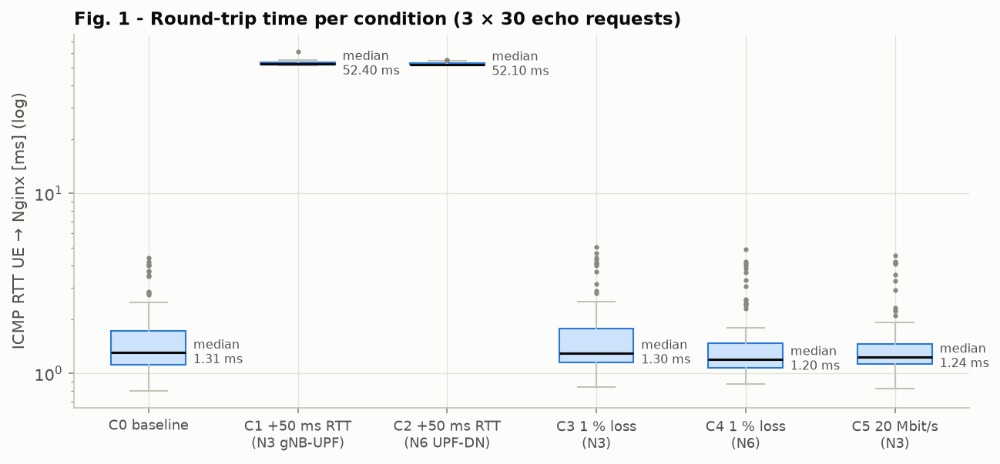
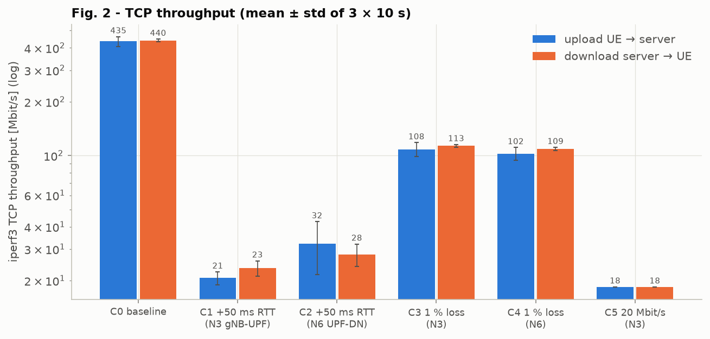
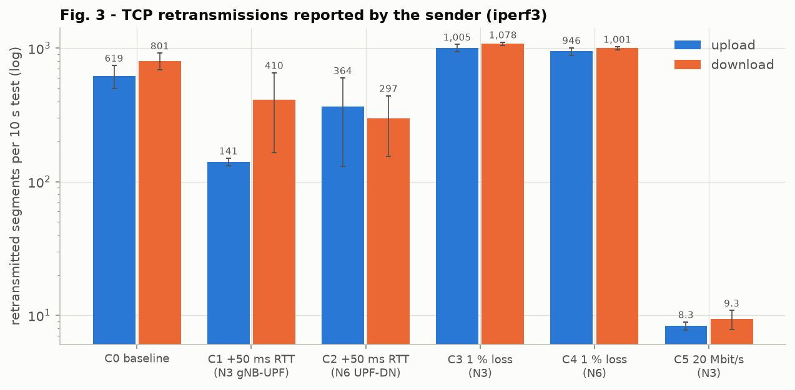
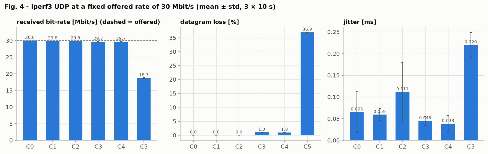
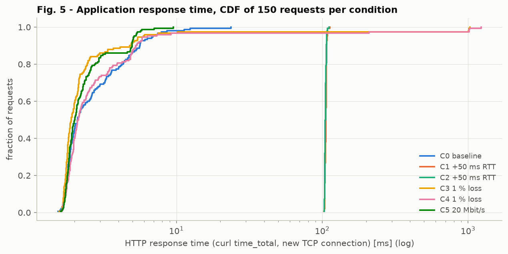
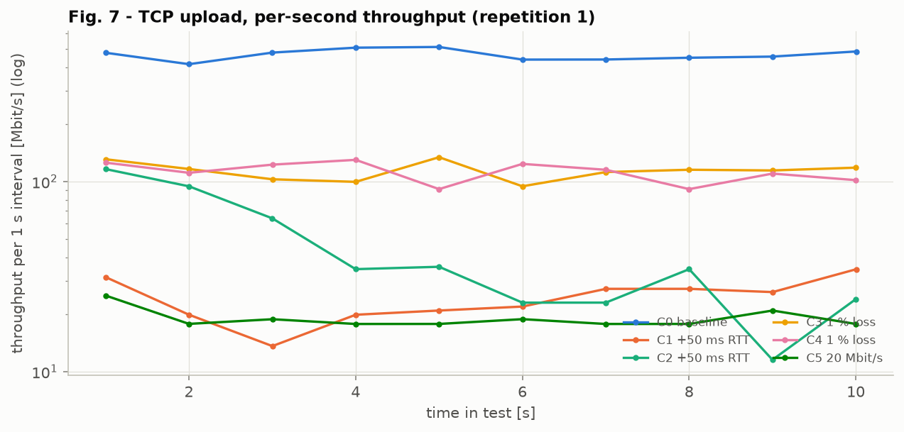

### 6.3 Interpretation

* **Baseline (Level 1-3).**
  * RTT 1.67 ms is 10× Scenario A. Each packet passes through three user-space programs: the UERANSIM UE (TUN → RLS/UDP), the gNB (RLS → GTP-U socket) and the Open5GS UPF (GTP-U socket → `ogstun`). Each costs a context switch and a copy.
  * TCP reaches 435-440 Mbit/s, limited by these single-threaded processes (CPU), not by any link.
  * The baseline has 600-800 retransmissions per 10 s (Scenario A: reordering). The capture shows 15 segments that reached N3 but not N6 (§6.4), so the UPF drops some packets under load.
* **+50 ms RTT (C1/C2).**
  * The RTT and connect time rise by exactly 50 ms, HTTP to 2 RTT (105 ms), and 1 MiB needs 10 RTT (≈ 510 ms).
  * TCP falls to only **21-32 Mbit/s**, far below the 521 Mbit/s of the same condition in Scenario A. The packet evidence explains why: with a larger BDP, the windows are larger and arrive at the UPF in bursts, and the UPF's GTP-U socket/TUN queues overflow. For example, C2 lost 425 segments between N3 and N6 although netem only *delays*.
  * The kernel counters of the UPF namespace confirm the mechanism: **`Udp RcvbufErrors` = 30,695** of 28.6 M received GTP-U datagrams (≈ 0.1 %) were dropped because the UPF's receive socket buffer was full. The counter is cumulative since the UPF restart in F2 and covers the timeline runs; snapshot in `results/udp_socket_counters.txt`. The gNB shows the same effect for the radio side (`RcvbufErrors` = 9,652).
  * Each loss at 53 ms RTT costs many RTTs of window regrowth, so the throughput collapses. The bottleneck is the software user-plane function, not the network condition alone. Scenario A's kernel forwarding did not have this problem.
* **1 % loss (C3/C4).**
  * TCP drops to ≈ 105 Mbit/s with ≈ 1000 retransmissions per 10 s. This is below the Mathis bound for the measured sRTT (168 / 150 Mbit/s, `results/model_check.md`); the additional software losses lower it further.
  * UDP loses 1.0 % and is **not** retransmitted. HTTP keeps 100 % success, but a lost SYN in C3 gave a 1 s retransmission timeout in one repetition, hence p95 189 ± 319 ms.
* **20 Mbit/s on N3 (C5).** The rate limit acts on GTP-U frames:
  * TCP: 1348 B payload per 1458 B frame (1400 B inner MTU + 44 B GTP-U/UDP/IP + 14 B Ethernet) → 20 × 1348/1458 = **18.49 Mbit/s** (measured 18.5).
  * UDP: 20 × 1372/1458 = 18.82 Mbit/s → expected loss at 30 Mbit/s offered = 37.3 % (measured 18.73 Mbit/s and 36.9 %).
  * The sRTT rises to 47 ms because the tbf queue fills (bufferbloat), while the short ping/HTTP tests (no load) are unaffected.
  * Unlike Scenario A, **tbf itself reports 0 drops** (327,464 *overlimits*). The gNB is a local sender: when the qdisc is full, its GTP-U `sendto()` fails (gNB **`Udp SndbufErrors` = 30,937**, cumulative; this counter only exists on the sending side and is the expected signature of a full egress queue), so the excess UDP is discarded inside the gNB process before it reaches tc. The tc counters alone would hide where the 37 % UDP loss happens.

### 6.4 N3 versus N6 - does the location matter?

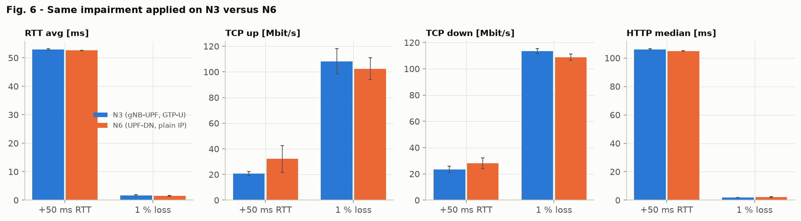

**End-to-end metrics: no.** The same impairment on N3 or on N6 produces the same RTT, HTTP time and UDP loss, and TCP within one standard deviation. A serial path experiences the sum of its impairments.

**Packet-level localisation: yes.** For each condition a 3 s TCP upload (50 Mbit/s) was captured at
P1 (UE tunnel), P3 (N3) and P5 (N6), and the data segments were counted at each point (`results/packet_evidence_table.md`):

| Condition | P1 UE | P3 N3 | P5 N6 | missing before N3 (UE/gNB/N3 egress) | missing between N3 and N6 (UPF/N6) | retrans. | dup ACKs | ACK RTT [ms] |
|---|---:|---:|---:|---:|---:|---:|---:|---:|
| C0 baseline | 14135 | 14135 | 14120 | 0 | 15 | 15 | 13 | 2.48 |
| C1 +50 ms N3 | 6341 | 6341 | 6275 | 0 | 66 | 66 | 281 | 55.80 |
| C2 +50 ms N6 | 14563 | 14452 | 14027 | 111 | 425 | 536 | 358 | 79.48 |
| **C3 1 % loss N3** | 14197 | **14063** | 14063 | **134** | 0 | 134 | 510 | 1.08 |
| **C4 1 % loss N6** | 14182 | 14182 | **14050** | 0 | **132** | 132 | 498 | 1.06 |
| C5 20 Mbit/s N3 | 5319 | 5312 | 5312 | 7 | 0 | 8 | 239 | 43.57 |

* **C3 vs C4:** the losses appear *before* the N3 observation point when netem sits on the gNB's N3 egress, and *between* N3 and N6 when netem sits on the UPF's N6 egress. The counts match the retransmissions one to one.
* The tc counters agree: drops are recorded on `gnb/eth0 + upf/eth1` in C3 and on `upf/eth0 + veth(N6)` in C4.
* An operator who only looks at end-to-end KPIs cannot tell N3 from N6. Per-interface captures (or per-interface counters) can, which is why the 5G architecture's interface separation matters for diagnosis.

---

## 7. Operational observability - Prometheus and Grafana

```
Open5GS AMF/SMF/PCF (:9090 on sbi-net), UPF (:9090 on n4-net)  ─┐
host exporter (UE probes, PDU state, N3/N6 counters, tc state)  ─┼─► Prometheus (10.20.7.30, 1-2 s scrape) ─► Grafana (10.20.7.40)
                                                                  │
            user plane UE → gNB → N3 → UPF → N6 is never used by these flows
```

| Source | Metrics used |
|---|---|
| AMF | `gnb`, `ran_ue`, `amf_session`, `fivegs_amffunction_rm_reginitreq/succ`, `fivegs_amffunction_amf_authreq`, `amf_authreject`, `amf_authfail{cause}` |
| SMF | `ues_active`, `pfcp_peers_active`, `pfcp_sessions_active`, `fivegs_smffunction_sm_pdusessioncreationreq/succ` |
| UPF | `fivegs_upffunction_upf_sessionnbr`, `pfcp_peers_active` |
| PCF | `fivegs_pcffunction_pa_policyamassoreq/succ`, `…smassoreq/succ` |
| `exporter/scenario_b_exporter.py` | `scenb_probe_rtt_ms`, `scenb_probe_http_seconds{phase}`, `scenb_probe_http_up`, `scenb_pdu_session_up`, `scenb_port_{rx,tx}_bytes_total{port=ue_tun\|gnb_n3\|upf_n3\|upf_n6\|upf_tun}`, `scenb_qdisc_drops_total`, `scenb_impair_*`, `scenb_ue_tcp_retrans_segs_total` |

The Grafana dashboard `deploy/grafana/provisioning/dashboards/scenario-b.json` has these panels:

* Panel 1 - Throughput, including UE tunnel vs N3 vs N6 bytes, which shows the GTP-U overhead;
* Panel 2 - RTT;
* Panel 3 - Packet loss / qdisc drops;
* Panel 4 - TCP retransmissions;
* Panel 5 - UE / PDU-session state (gNBs, RAN UEs, SMF UEs, PFCP sessions, UPF sessions, uesimtun0);
* Panel 6 - Application response time;
* service availability, configured impairment per segment, and 5GC procedure counters.

### 7.1 Timeline experiment - N3 and N6 impairments under load

`07_timeline.sh` runs one long iperf3 TCP upload from the UE through the PDU session while the condition
changes every 35-60 s. `analysis/timeline.py` exports the Prometheus series (`/api/v1/query_range`, step 1 s)
to `data/timeline_prometheus.csv`, and `analysis/grafana_snapshot.py` renders the dashboard of the same run.

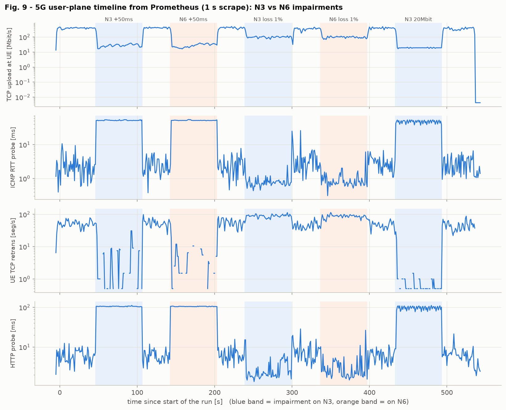

| Phase | Impairment | TCP up median [Mbit/s] | N3/N6 bytes | RTT probe median [ms] | UE retrans/s | drops/s N3 | drops/s N6 | HTTP probe median [ms] | HTTP availability | UPF / SMF sessions |
|---|---|---:|---:|---:|---:|---:|---:|---:|---:|---:|
| baseline | none | 403.6 | 1.032 | 2.16 | 52.6 | 0 | 0 | 5.76 | 100 % | 1 / 1 |
| N3 +50ms | n3 delay 25 ms | 28.1 | 1.031 | 51.90 | 3.1 | 0 | 0 | 105.85 | 100 % | 1 / 1 |
| recovery-1 | none | 418.5 | 1.032 | 2.20 | 52.6 | 0 | 0 | 5.97 | 100 % | 1 / 1 |
| N6 +50ms | n6 delay 25 ms | 27.9 | 1.032 | 51.90 | 2.3 | 0 | 0 | 105.03 | 100 % | 1 / 1 |
| recovery-2 | none | 434.2 | 1.032 | 2.34 | 55.9 | 0 | 0 | 5.69 | 100 % | 1 / 1 |
| N3 loss 1% | n3 loss 1 % | 100.4 | 1.031 | 0.73 | 89.4 | **131.7** | 0 | 2.01 | 100 % | 1 / 1 |
| recovery-3 | none | 354.9 | 1.032 | 2.87 | 45.5 | 0 | 0 | 6.28 | 100 % | 1 / 1 |
| N6 loss 1% | n6 loss 1 % | 99.4 | 1.042 | 0.75 | 87.8 | 0 | **87.8** | 2.12 | 100 % | 1 / 1 |
| recovery-4 | none | 405.0 | 1.032 | 2.72 | 47.8 | 0 | 0 | 5.88 | 100 % | 1 / 1 |
| N3 20Mbit | n3 tbf 20 Mbit/s | 19.2 | 1.031 | **48.50** | 0.5 | 0 | 0 | **99.85** | 100 % | 1 / 1 |
| recovery-5 | none | 360.3 | 1.032 | 2.59 | 42.2 | 0 | 0 | 6.13 | 100 % | 1 / 1 |

What the time series add to the Step 3 results:

* **The GTP-U overhead is a constant 3.1-3.2 %.** The N3 uplink byte rate is 1.031-1.032 × the N6 byte rate in every phase (44 B per ≤ 1400 B packet). In the N6-loss phase the ratio rises to 1.042, because 1 % of the bytes counted on N3 are dropped before they are counted on N6. This is the impairment *location* visible in pure counters.
* **The qdisc drop counters tell N3 from N6 in real time.** Drops appear only on the `gnb_n3`/`upf_n3` series in the N3 phase and only on `upf_n6` in the N6 phase (Panel 3). The end-to-end throughput, RTT and HTTP are the same in both.
* **Bufferbloat under load.** With the saturating upload, the 20 Mbit/s N3 bottleneck queue raises the RTT of the small ICMP probe to 48.5 ms and the HTTP probe to 100 ms. The unloaded Step 3 measurement (C5) showed 1.6 ms. The RTT even *drops* below baseline in the loss phases (0.7 ms vs 2.2 ms), because the TCP flow backs off to 100 Mbit/s and the user-space forwarders are less loaded.
* **The session state never changed** (UPF sessions = SMF PFCP sessions = AMF RAN UEs = 1, uesimtun0 up, HTTP availability 100 %). The impairments degrade the service but do not break it, which is the difference to the failures in §8.
* **Each change is visible within 1-3 s and recovers within a few seconds** after `tc qdisc del`, without any 5G signalling: N2, N4 and the SBI are untouched by user-plane impairments.

**Grafana dashboard** of the same run (rendered headless):

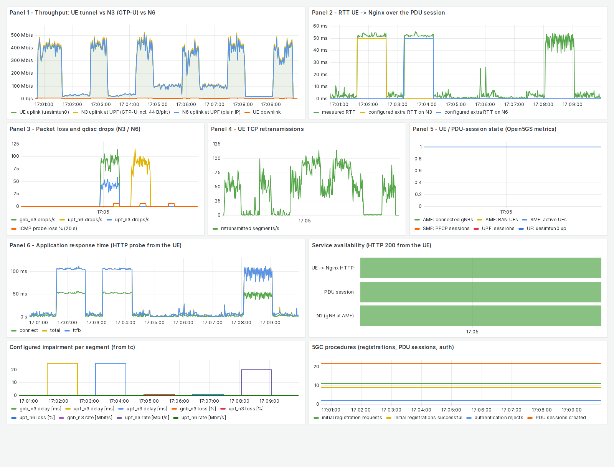

**Purpose and limits of the observation methods in Scenario B:**

* **`docker ps`** shows processes only. In F2 and F3 the UE, gNB, AMF and SMF were all *Up*.
* **`nr-cli` and the AMF/SMF metrics** show the *control-plane view* (registered, PDU session active). In F2 and F3 they kept reporting "active" while no user data could flow.
* **Captures** are the only proof that a packet crossed N3/N6, but they have limits:
  * N3 needs GTP-U decoding;
  * SBI headers may be undecodable (HPACK);
  * the simulated radio is opaque (RLS).
* **Prometheus** correlates everything over time, but at 1-2 s resolution.
* **Grafana** only displays what Prometheus holds.
* The exporter's own health checks run in the UE namespace and must tolerate full CPU load. An earlier version reported false "PDU session down" samples when `docker inspect` timed out; the final version keeps the last known state.

---

## 8. Failure diagnosis

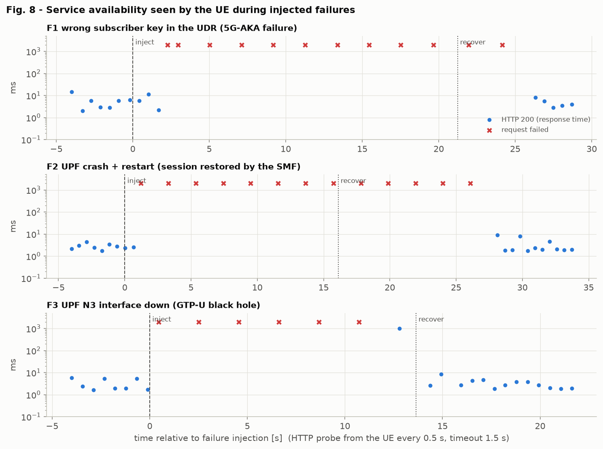

`06_failure.sh` ran an HTTP probe from the UE every 0.5 s (timeout 1.5 s) and captured N2, N3, N4 and N6
for each case (`results/failure/`, `captures/failure/*.pcap.gz`, `results/failure/packet_summary.txt`):

| Case | Availability before | During | First failed probe after injection | First success after the fix | curl error |
|---|---:|---:|---:|---:|---|
| F1 wrong subscriber key | 100 % | 23 % ¹ | 2.3 s | 5.1 s (UE power-cycle + registration) | 28 (timeout) |
| F2 UPF crash + restart | 100 % | 20 % ¹ | 1.2 s | **12.0 s** after `docker start` | 28 |
| F3 N3 link down | 100 % | 14 % ¹ | 0.5 s | 0.7 s after link up | 28 |

¹ The successes inside the window are the probes that ran before the fault took effect: the UE restart in F1, `docker stop -t 1` in F2, and one probe in F3 that completed through a SYN retransmission right after the fix.

Packets per interface **during** each failure window:

| Case | N2 NGAP | N4 PFCP | N3 GTP-U uplink | N3 GTP-U downlink | N6 packets |
|---|---:|---:|---:|---:|---:|
| F1 | 4 (Registration, Auth request, **Auth failure**, **Auth reject**) | 10 (heartbeats only) | 21 ² | 15 ² | 38 ² |
| F2 | 0 | 4 (**unanswered heartbeats**) | 32 | 11 ³ | 24 |
| F3 | 0 | 4 (heartbeats answered) | **16** | **0** | 1 |

² F1: user traffic of the old session before the UE restarted.
³ F2: only in the first second, while the UPF process was terminating.

#### F1 - Wrong subscriber key in the UDR (authentication failure)

| Step | Evidence |
|---|---|
| Injection | MongoDB: `security.k` of IMSI 001010000000001 changed to `0011…EEFF`; UE power-cycled |
| Symptom | No PDU session: `uesimtun0` is missing, every HTTP probe fails. UE `RM-DEREGISTERED`, `MM-DEREGISTERED/NO-SUPI`, `sim-inserted: false`. |
| N2 / NAS evidence | `Registration request` → `Authentication request` → **`Authentication failure (MAC failure)`, 5GMM cause #20** → **`Authentication reject`**. There is no Security Mode, no InitialContextSetup, and no N4/PFCP or GTP-U for this UE. |
| UE log | `AUTN validation MAC mismatch. expected [711146E9…] received [4D5BCF58…]`, `Sending Authentication Failure with cause [MAC_FAILURE]`, `Authentication Reject received` |
| AMF log / metrics | `Authentication failure(MAC failure)`, `Authentication reject`. Metrics: `fivegs_amffunction_amf_authfail{cause="20"} 1`, `amf_authreject 1`, `amf_session 0` |
| Root cause | The home network derives the authentication vector (AUTN) from a different K than the USIM. The UE rejects the *network* (mutual authentication), so the network itself is perfectly healthy, which N3/N4 confirm. |
| Recovery | Subscriber restored, UE power-cycled → the next registration completes normally (Authentication response, Security mode complete, Registration accept, PDU session). The AMF first releases the UE context left over from the failed attempt (`UEContextReleaseCommand, normal-release`). |

#### F2 - UPF crash and restart

| Step | Evidence |
|---|---|
| Injection | `docker stop scenario-b-upf` |
| Symptom | All HTTP probes time out (curl exit 28). |
| Misleading state | The UE remains `RM-REGISTERED` with PDU session `PS-ACTIVE`, `uesimtun0` up; the gNB is fine. **12 s after the crash the SMF still reports `pfcp_peers_active 1`, `pfcp_sessions_active 1`.** |
| N3 evidence | The gNB keeps sending uplink GTP-U to 10.20.3.14 (32 packets in the failure window). Downlink GTP-U stops once the UPF process has exited (11 packets, all in the first second while `docker stop` was terminating it). |
| N4 evidence | The UPF's last heartbeat is answered, then **3 PFCP Heartbeat Requests from the SMF stay unanswered** (2.5 s apart). SMF log: `No Heartbeat from UPF` → `No UPF available` → `PFCP de-associated`. The detection time on N4 is ≈ 14 s after the crash. |
| Restart | `docker start` → the SMF's Association Setup Requests first get **ICMP port unreachable** (UPF container up, PFCP server not yet started), then an **Association Setup Response**. SMF log: `Remote PFCP restarted [4001751268<4001751470]` (the PFCP Recovery Time Stamp increased) → `PFCP restoration` → UPF log `[Added] Number of UPF-Sessions is now 1` |
| Root cause and lesson | The forwarding state (PDRs/FARs) lives only in the UPF process and was lost with it. Open5GS's SMF still held the session context, detected the restart through the recovery time stamp and **re-installed the session over N4**. The **user plane was usable again 12.5 s after `docker start`, without any UE or NAS signalling**: no new registration and no new PDU session (same UE IP). |

#### F3 - N3 interface of the UPF down (GTP-U black hole)

| Step | Evidence |
|---|---|
| Injection | `ip link set eth1 down` inside the UPF (N3 port 10.20.3.14) |
| Symptom | HTTP and ping from the UE fail (100 % loss). |
| Healthy control plane | gNB `is-ngap-up: true`; UE `RM-REGISTERED`, PDU session `PS-ACTIVE`; SMF `pfcp_peers_active 1`, `pfcp_sessions_active` unchanged; N2 shows only SCTP heartbeats, N4 only PFCP heartbeats with responses |
| N3 evidence | **16 uplink GTP-U packets, 0 downlink.** The gNB keeps encapsulating, nothing comes back. N6 sees no UE traffic. |
| System evidence | UPF `eth1: <BROADCAST,MULTICAST> state DOWN` (no `UP`, no `LOWER_UP`), while the gNB N3 interface is `UP,LOWER_UP` and keeps transmitting |
| Root cause | User-plane transport failure on N3 only. It is invisible to N2 and N4, because PFCP runs on a separate interface and does not test the GTP-U path (there are no GTP-U echo requests in this setup). |
| Recovery | Link up → traffic resumes immediately (same TEIDs, no signalling). |

**Comparison of the three failures:**

| | F1 auth failure | F2 UPF restart | F3 N3 down |
|---|---|---|---|
| UE registered? | no | yes | yes |
| PDU session at UE | none | active (stale during the outage) | active |
| N2 | failure messages | normal | normal |
| N4 | no session | heartbeats fail → re-association | normal |
| N3 | no traffic | uplink only | uplink only |
| Detected by | NAS cause + AMF metric | SMF heartbeat (≈ 14 s) + PFCP recovery timestamp | only user-plane probes / N3 counters |

These cases show the assignment's point: container state, registration state and even PFCP state
can all look healthy while the user plane is broken (F3). Only interface-level packet evidence
proves the data path.

---

## 9. Repository layout and limitations

```
scenario-b/
├── README.md                 this report
├── deploy/                   docker-compose.yml, open5gs/*.yaml, ueransim/{gnb,ue}.yaml, mongodb/add_subscriber.js,
│                             nginx/, prometheus/, grafana/provisioning/ (dashboard scenario-b.json)
├── scripts/                  lib.sh, 00_install, 01_deploy, 02_verify, 03_capture, impair, 04_measure,
│                             05_experiments, 06_failure, 07_timeline, run_all, 99_teardown
├── exporter/                 scenario_b_exporter.py
├── analysis/                 step2_analysis.py, parse_results.py, analyze.py, failure_analysis.py, timeline.py, ...
├── results/                  step1/, step2_logs/, raw/<condition>/, failure/, timeline/, summary tables
├── captures/                 step2/ (N2, N3, N4, N6, SBI, radio, uesimtun0), step3/*.pcap.gz, failure/*.pcap.gz
├── data/                     measurements.csv, ping_samples.csv, http_requests.csv, iperf_intervals.csv, ...
└── figures/                  fig1-fig10
```

**Limitations:**

* **The radio is simulated.** UERANSIM's RLS over UDP has no PHY/MAC/RLC behaviour (no HARQ, scheduling, fading), so N3/N6 effects are measured without radio effects.
* **User-space data plane.** gNB, UE and UPF are single-process user-space forwarders. Absolute throughput and the burst losses in §6.3 are properties of this software on a 4-vCPU VM, not of 5G.
* **Lab security settings.** NEA0 (null ciphering) and SUCI null scheme make NAS and the IMSI readable. Real deployments use NEA2 and SUCI concealment.
* **HTTP/2 decoding gaps.** NF connections opened before a capture starts have HPACK state that tshark does not know, so a few SBI headers are not decodable. Those requests are marked `*` / `n/d` in the timeline.
* The same netem caveats as Scenario A apply (Bernoulli loss, constant delay), with 3 repetitions per condition.
